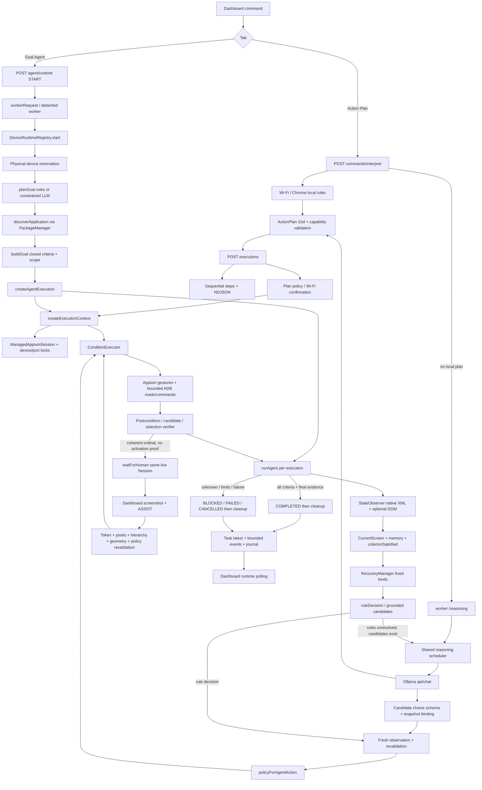

# Phone Commander: General-purpose Android Agent Source Audit

Ngày kiểm toán: 2026-10-18. Repository: Smart Device Control System / Phone Commander.
Baseline Git: nhánh `DuyTD`, HEAD `35c88b4`; **kiểm toán working tree, không chỉ HEAD**. Working tree có các thay đổi Current Screen Understanding và sửa Chrome chưa commit từ công việc trước. Các số dòng bên dưới áp dụng cho hiện trạng này, có thể thay đổi khi commit/refactor.

Phạm vi lượt audit: đọc source, tìm symbol/dependency, mô phỏng offline, chạy test offline và tạo duy nhất báo cáo này. Không sửa business logic/configuration, cài dependency/model, gọi AI thật, điều khiển Android hoặc truyền dữ liệu thiết bị ra dịch vụ ngoài trong giai đoạn audit. Những lần thử Android trước audit không được dùng làm bằng chứng T1–T5.

## A. Executive Summary

**Kết luận:** có một nền tảng evidence-grounded đáng tái sử dụng, nhưng chưa phải general-purpose Android agent. Tên gọi dynamic/adaptive không đồng nghĩa mục tiêu, thao tác và verifier đã mở.

Mười phát hiện quan trọng nhất:

1. Có hai pipeline thật: Action Plan tuần tự và Goal Agent có observe–decide–execute–verify. Không nên gộp thành một khả năng tự chủ chung. [AP] [LOOP]
2. GoalSpec chỉ có sáu operation; Criterion chỉ có sáu loại. Không biểu diễn được kết quả ảnh được lưu, báo thức bật, phép tính hay ghi chú persist. [GS]
3. `buildGoal()` tạo subgoal theo bảng điều kiện, một app/package chính; `REPLAN_SUBGOAL` chỉ quay lại tiêu chí đã có, không sinh decomposition tùy ý. [GP] [LOOP]
4. Dynamic app discovery **đã có**, dùng Android intents/PackageManager và launcher evidence, nhưng không có catalog tên hiển thị đầy đủ hoặc lựa chọn theo chức năng bất kỳ. [APP]
5. Snapshot khá giàu dữ liệu và bảo vệ stale/device/context; current-screen/capability recognition vẫn dựa regex, resource ID và tập trạng thái hữu hạn. [OBS] [NAV]
6. Candidate generator chỉ sinh một tập navigation/read hữu hạn, tối đa sáu lựa chọn; Qwen không thể chọn nút bị generator loại bỏ. Đây là giới hạn lớn hơn việc model thiếu thông minh. [CAND] [DEC]
7. `VisionGroundingProvider` chỉ là interface. Engine hiện trả `GEOMETRY_ONLY`, `visionAvailable:false`; OCR/VLM/semantic image detection đang chạy: **NOT FOUND**. [VIS]
8. Có phân biệt SENT/VERIFIED/COMPLETED, nhưng criterion video có nhánh chấp nhận metadata tiêu đề mà không bắt buộc playback tiến triển. Vì thế “đúng trang video” và “đang phát” chưa được tách đầy đủ. [AV] [EVAL]
9. Hai vấn đề ngữ nghĩa tái hiện offline: “Đồng hồ” va guard `dong` của “đóng”; model output `OPEN_APP` cho câu yêu cầu tính toán có thể được chấp nhận chỉ với FOREGROUND, làm mất outcome. [GP] [TEXT]
10. Runtime có isolation/locks/journal/shared queue thật; giới hạn bốn execution và một model request chạy đồng thời. Không có bằng chứng 100 máy, benchmark tải nhiều máy hoặc nghiệm thu T1–T5. Local config chọn Qwen 3B, trong khi Modelfile vẫn ghi 7B; tiến trình đang load model gì chưa được probe trong audit. [RT] [QUEUE] [MODEL]

**Năm blocker lớn nhất:** biểu diễn outcome đóng; candidate/permission scope chỉ đọc; verifier outcome/persistence thiếu; thiếu discovery/capability và navigation tổng quát; thiếu artifact/dataflow nhiều ứng dụng. Không thể giải quyết bằng thêm alias Camera hoặc tắt policy.

Khuyến nghị: một pipeline outcome-driven duy nhất trên runtime/observer/locks hiện có; typed capability contracts và evidence predicates do backend kiểm soát; model chỉ đề xuất goal graph và chọn grounded candidate, không sinh selector/tọa độ/shell có thể thực thi trực tiếp. Chưa triển khai trong lượt này.

## B. Verified Repository Inventory

### Quy ước bằng chứng

| Nhãn | Ý nghĩa |
|---|---|
| SOURCE_VERIFIED | Đã đọc implementation hiện hành và đối chiếu call path. Không ngụ ý Android thật đã chạy thành công. |
| TEST_VERIFIED | Đã chạy test/probe offline và quan sát kết quả trong audit; ghi rõ dependency được mock. |
| REPORTED_ONLY | Số liệu từ tài liệu cũ, chưa chạy lại hoặc xác thực artifact gốc. |
| UNVERIFIED | Cần model/runtime/Android/hardware thật hoặc thông tin hiện chưa đọc. |
| NOT FOUND | Không tìm được implementation trong phạm vi source/dependency đã tìm; không phải khẳng định mọi file trên máy đều không có. |

Các reference bên dưới trỏ tới **file thật** và dòng khởi đầu symbol; phần đề xuất dùng chữ PROPOSED và không coi là inventory.

| Nhóm | File/symbol đã xác minh | Vai trò, giới hạn |
|---|---|---|
| Dashboard | `components/commands/AICommandPanel.tsx:45`, `AgentGoalPanel.tsx:45`; [HOOK] `useAgentRuntimes:8` | Hai tab; Action Plan và Goal Agent không dùng cùng orchestration. Poll runtime và gửi START/ASSIST/CANCEL. |
| API Action Plan | [INT] `POST`; [AP] `POST:22` | Interpret rules/LLM → Zod/capability validation; execute tuần tự, NDJSON, fail dừng bước sau. |
| API Agent | [API] `POST:7`; [RAPI] `GET:4`, `POST:18`; `app/api/agent/assistance/route.ts:12` | NDJSON compatibility hoặc task API; proxy worker, evidence ảnh và xác nhận. |
| Worker | [WC] `workerRequest:31`, `ensureWorker:14`; [WS] `startWorker:19` | Detached Node process, loopback bearer, owner lock, tasks journal. Không phụ thuộc vòng đời tab Dashboard. |
| Goal/planning | [GS] `GoalSpecSchema:5`, `CriterionSchema:15`, `GoalSchema:39`; [GP] `buildGoal:38`, `planGoal:81` | Closed operations, rules trước model, criteria backend dựng. |
| App discovery | [APP] `discoverApplication:25`, `bindDiscoveredApplication:57` | PackageManager reads, category intents, token/package match, WeakSet/WeakMap grants. |
| Runtime | [RT] `androidRuntimeAdapter:23`, `DeviceRuntimeRegistry:39`; [RSC] `RuntimeCommand:5` | Task per device/execution, batch, cancel, no restart auto-resume. |
| Agent loop | [LOOP] `policyForAgentAction:41`, `runAgent:95`, `createAgentExecution:322` | Fresh reads, budgets, candidates, verification, recovery, finally cleanup. |
| AI | [DEC] `ruleDecision:24`, `AgentDecisionEngine:101`; [OLL] `OllamaAgentReasoner:13`; [QUEUE] `ReasoningScheduler:5` | Rules trước model; model chọn candidate ID; shared concurrency 1. |
| State/UI | [OBS] `StateObserver:107`; `snapshot.ts:ScreenSnapshotSchema`; [SCREEN] `classifyScreen:6`; [NAV] `understandCurrentScreen:34` | Native XML, package/activity/viewport, optional DOM, heuristic screen/capabilities. |
| Grounding | [CAND] `generateActionCandidates:38`, `revalidateCandidate:149`; `interaction-target-resolver.ts:16` | Snapshot-bound IDs, unique target, bounds/ancestor/coverage, refresh trước click. |
| Exploration | [EXP] `UIExplorer:26`; [EC] `explorationGoal:34`; `scroll-controller.ts`, `scroll-regions.ts`, `element-memory.ts` | Bounded scroll, ordinal continuity, ads/Shorts filters, no-gap counting. |
| Execution | [CE] `ConditionExecutor`, `createExecutionContext:373`; [ADB] `createAndroidExecutor:14` | Appium condition executor hoặc legacy ADB; seven plan actions thực thi, SCREENSHOT endpoint riêng. |
| Appium resources | [SESSION] `acquireDeviceLock:32`, `ManagedAppiumSession:109`; `port-allocator.ts:15`; `session-operation-lock.ts:8` | Physical alias locks, ports, native/WebView mutual exclusion, cleanup uncertainty. |
| Verification | [AV] `verifyDiscoveredSelection:17`, `verifyClickTransition:85`; [CV] `verifyCandidateOutcome:11`; [EVAL] `criterionSatisfied:11` | Một số postcondition reusable, phần lớn goal semantics hữu hạn. |
| Visual/human | [VIS] `VisualGroundingEngine:63`, `VisionGroundingProvider:29`; [HUM] `waitForHuman:26` | Pixel/geometry evidence và limited human-tap resume; không có vision inference. |
| Recovery/memory | [REC] `RecoveryManager:38`; [MEM] `AgentMemory:10` | Fixed recovery kinds; history, repeats, no unsafe action replay. |
| Policy | [POL] `assessPlanPolicy:34`, `assertObservedControlSafe:91`; [MODE] `developmentPolicyEnabled:1` | Mode khác nhau; strict không phải cấu hình local đang chọn. |
| System adapters | `wifi-control.ts:54`, `wifi-network.ts:23`; [MEDIA] `createMediaPlaybackVerifier:41` | Wi-Fi state và media-session evidence có kiểm soát; không phải generic persisted-data adapter. |
| Browser | [WEB] `HybridContextObserver:91`, `clickOrdinal`; [BD] `resolveBrowserDestinationUrl:14` | DOM/native address binding, heading links, Google-specific result extraction/redirect handling. |
| Dependency | `package.json` | Next 16.4.0, React 19.3.0, TS, Zod, fast-xml-parser, sharp. Appium được gọi HTTP; Ollama qua fetch; không có OCR/VLM library trong dependencies. |

Không có thư mục `lib/ai`, `lib/ollama` hoặc `services` tại các vị trí đã tìm. AI code thật nằm trong `lib/android/agent`. Không suy ra thiếu AI chỉ vì không có các tên thư mục đó.

### Config đã kiểm tra an toàn

Chỉ trích đúng các key cấu hình không bí mật bằng allowlist, không dump `.env.local`, token, address journal hay credentials:

- `.env.local`: `OLLAMA_MODEL=qwen2.5:3b-instruct`; `ANDROID_POLICY_MODE=development`.
- `ollama/Modelfile:1`: `FROM qwen2.5:7b-instruct`, custom interpreter system prompt.
- [OLL] dùng biến `OLLAMA_MODEL`, fallback `phone-commander`, text messages, không gửi images.
- Model đã cài, process đã load, CPU/GPU placement và các bản Ollama/Appium thực tế trong lúc audit: **UNVERIFIED**; không gọi API model/device để kết luận.
- Việc Modelfile 7B khác runtime selection 3B là cấu hình lệch cần ghi nhận, không chứng minh model 7B đang chạy.

### Test đã chạy trong audit

PowerShell, executable Node thực tại môi trường này:

```powershell
$testFiles=(Get-ChildItem tests -Filter '*.test.cjs').FullName
& 'C:\nvm4w\nodejs\node.exe' --test $testFiles > .next/general-agent-audit-tests.tap
```

**TEST_VERIFIED: 346/346 pass, 0 fail/skipped, 26.542 s.** Android/model dùng fake adapters; một số test chạy HTTP loopback và filesystem thật. Không chạy `*.integration.cjs`; không phải E2E trên Android hoặc benchmark inference. Test log là artifact tạm ignored, không cần commit.

Thêm một probe Node offline gọi implementation thật `discoverApplication()` với mocked PackageManager rồi `buildGoal()` với **output model giả lập OPEN_APP**. Không gọi `runAdb`, không gọi Ollama. Hai lần probe đã chạy: lần đầu cố tình/chưa khớp tên tiếng Việt nên bị name-preservation guard; lần sau dùng đúng requested name cho T1–T5, kết quả chi tiết ở F. Chỉ probe lần sau có ý nghĩa cho các kết luận T1–T5. Không sửa/tạo test business code trong lượt audit.

## C. Actual Execution Architecture



Sơ đồ thể hiện **hai nhánh**. Qwen planner đi qua `OllamaAgentReasoner` vào cùng scheduler trong worker; interpreter dùng worker `/reasoning`. Không phải request nào cũng gọi model. Các cạnh human chỉ có ở failure đủ điều kiện, không áp dụng mọi UNKNOWN.

### Control/data flow thật

1. `AgentGoalPanel` gửi START `{requestId,jobs:[{deviceId,goal}]}` qua [HOOK]/[RAPI]. Schema task commands chặn shape sai; API kiểm tra local origin. [RSC]
2. [WC] tìm worker cùng workspace, health check, nếu thiếu mới spawn detached; worker [WS] có bearer và process owner lock. Audit chỉ đọc implementation, không gọi ensureWorker.
3. [RT] reject duplicate request/job, cùng serial/physical alias, offline/unverified wireless, hơn bốn execution. Mỗi entry có AbortController, Promise `done`, task và memory riêng. Các entry được schedule bằng Promise, không await tuần tự cả batch.
4. `androidRuntimeAdapter.plan` gọi `planGoal(request,budget,... discoverApplication(serial,...))`; spec từ local rules hoặc schema-bound model. `buildGoal` kiểm app/request/outcome/policy rồi dựng criteria/scope. App evidence giữ bằng WeakMap cùng object goal, không persist grant qua restart.
5. `createAgentExecution` mở context; `ManagedAppiumSession` sở hữu sessionId/ports/serial. `createExecutionContext` sở hữu device lock, observer/explorer/visual per execution. Không tạo session mới mỗi action. [SESSION] [CE]
6. `runAgent` đọc snapshot, kiểm device identity, ghi screen memory, đánh giá current criterion, hỏi recovery/decision. Output model chỉ có ID trong manifest, snapshotId/subgoalId/reason. Grounding kiểm lại trước và ngay trong executor. [LOOP] [CAND]
7. Executor trả `ActionOutcome {verification,postcondition,evidence,selection,...}`. Postcondition callback có actual snapshot. Loop có thể tái sử dụng snapshot verified dưới 5 s cho **completion**, không dùng nó làm snapshot để dispatch action tiếp theo.
8. Human wait giữ nguyên async stack/session/lock đến deadline; chỉ khi coherent ordinal activation problem. General unknown emits non-resumable assistance rồi BLOCKED. [HUM] [VIS] [LOOP]
9. Completion do backend kiểm criteria; cuối cùng close session/release lock. Cleanup không chắc chắn giữ ownership, không tự tạo session thay thế. Registry bỏ visual/token khi finished, journal chỉ giữ task summary. Worker restart chuyển unfinished task thành BLOCKED, không khôi phục coroutine/session. [RT] [SESSION]
10. [HOOK] poll 2 s khi active, 5 s idle, 15 s hidden. NDJSON compatibility [API] poll 750 ms. Viewer disconnect không cancel worker goal; Action Plan stream cancel/request abort **có** cancel context.

### Timeout, retry, shared state

| Phạm vi | Cơ chế đã đọc |
|---|---|
| Goal | Mặc định 240 s; max 300 s; 18 steps, 120 snapshots, 24 scrolls, 4 reasoning, 2 retries, 2 replans, 40 iterations. [GS] [BUD] |
| Recovery | Depth 2, tối đa 3 subtasks, mỗi subtask 2 attempts/15 s theo default; chung parent budget. [REC] [GS] |
| Model | Agent ≤45 s gồm queue; interpreter worker default/max 180 s; worker-client reasoning transport 181 s. [OLL] [WS] [WC] |
| Human | ≤120 s và không vượt goal remaining; session newCommandTimeout 180 s. [HUM] [SESSION] |
| Exploration | Default 120 s, 24 scrolls; empty-video 90%, after discovery 60%, generic 35%; overlap refinement và settle checks, không phải cuộn vô hạn. [EC] [EXP] |
| Resources | Một active execution/physical device; unique Appium system/Chromedriver/(optional MJPEG) ports; context lock reentrant. [SESSION] |
| Shared | Registry/worker process, queue concurrency 1 capacity 16, journal writes, OS CPU/RAM, Appium server/ADB daemon. Không share selection/goal memory/driver session giữa devices. [RT] [QUEUE] [WS] |

## D. Detailed Audit Q1–Q56

Trừ mục có nhãn khác, các trả lời sau là SOURCE_VERIFIED, không phải acceptance thật.

### Goal Planner / Schema

| Câu | Kết luận và bằng chứng |
|---|---|
| Q1 | `OPEN_APP`, `FIND_ELEMENT`, `FIND_PLACE`, `SEARCH`, `OPEN_RESULT`, `OPEN_PAGE`. SEARCH/OPEN_RESULT chỉ hợp lệ với YouTube video hoặc Chrome browser. [GS]:5; [GP] `buildGoal`. |
| Q2 | Có: enum operation, discriminated criteria, allowedActionScope, single app, max 8 subgoals. Model không thể bổ sung operation mới bằng prompt. [GS]:5–45. |
| Q3 | “Mở Camera và chụp một tấm hình” không match supported clear goal; generic parser không được nuốt compound `và` vào app. Đi tới LLM trong runtime. Schema không có CAPTURE; nếu model hạ xuống OPEN_APP Camera và app được discover thì `buildGoal` reject từ `chup`. Model lỗi schema cũng fail. Nếu discovery thất bại thì dừng sớm hơn. Không có automatic camera fallback. [GP]:81,38; probe F. |
| Q4 | Main subgoals là template criteria do backend dựng, không phải dynamic goal graph. Dynamic recovery chỉ tạo instance từ năm RecoveryKind định sẵn. [GP] `criteria`; [REC]:13. |
| Q5 | `intent` trong ActionPlan là string nhãn, không executable objective; `Action` là primitive; `GoalSpec.operation` chọn lớp mục tiêu; subgoal chứa Criterion; RequiredCapability ánh xạ từ criterion/current state; desired outcome tự do có description nhưng không có contract riêng. [ACT] [GS] [NAV]:70. |
| Q6 | Tham số query/ordinal/target được điền động, **loại success evidence không động**. FOREGROUND/SEARCH_RESULTS/TARGET_VISIBLE/READ_LOCATION/NATIVE_PAGE/DESTINATION do code quyết định. [GP] [EVAL] |
| Q7 | Goal có một app/package; named multi-app goals bị từ chối, package allowance chỉ có ngoại lệ Settings. Memory giữ selection và snapshots ngắn hạn, không có typed artifact/reference giữa app A và B. Cross-app workflow/data lineage: NOT FOUND. [GP] namedApps; [NAV]:127; [MEM] |
| Q8 | Planner thực sự gọi `reasoner.generate(GoalSpecSchema,...)` khi rules không match. Qwen cũng chọn candidate khi ruleDecision không quyết định được và còn grounded options. ActionPlan interpreter gọi `/reasoning` khi không có local rule. Không phải mọi vòng loop đều dùng Qwen. [GP]:81; [DEC]:101; [INT]; [OLL] |
| Q9 | Không có fallback open-world sau schema/buildGoal/discovery reject. Ngoại lệ lên runtime task FAILED; trong loop unknown thường NEED_HUMAN_ASSISTANCE/BLOCKED, nhưng không chuyển unsupported outcome thành workflow mới. [RT] execute; [LOOP] |

### App Discovery / Selection

| Câu | Kết luận và bằng chứng |
|---|---|
| Q10 | Alias cố định Chrome/YouTube/Settings; Agent có discovery package hoặc một số category intent, sau đó xác minh launcher. “Supported apps” không bằng danh sách mọi app có thể mở bằng package. [CAP]:4; [APP]:10,25. |
| Q11 | Có package hardcode ở aliases, classifiers, target matching, verifier, policy và Settings exceptions. Category Camera dùng Android standard intent, không hardcode Samsung Camera package. [CAP] [SCREEN] [TARGET] [NAV] |
| Q12 | Có thể với exact package/Android category default hoặc tên khớp duy nhất các token trong package. Không bảo đảm tên hiển thị tiếng Việt bất kỳ được tìm. Mở app không cần profile không đồng nghĩa thao tác chức năng trong app. [APP] |
| Q13 | `query-activities` lấy launchable components/packages; `resolve-activity` xác minh component. Display-label extraction/index từ APK/PackageManager: NOT FOUND. Không có app catalog đầy đủ và capability metadata. [APP]:25. |
| Q14 | Một phần, trong categoryIntents Camera/Calendar/Calculator/Gallery và alias tiếng Việt. Không có arbitrary function-to-app planner hoặc intent capability catalog tổng quát. [APP]:10. |
| Q15 | Chỉ nhận unique default/unique token match, reject resolver/chooser/ambiguous; yêu cầu exact package. Không có ranking theo capability, lịch sử hoặc người dùng chọn giữa nhiều app trong flow. [APP] |
| Q16 | Serial validation, allowed character/package/component patterns, unique launcher, verified WeakSet, goal-bound grant và per-device binding. Scope/policy kiểm tiếp. Không phải app allowlist toàn cục chỉ ba package trong mọi execution mode. [APP]:57; [LOOP]:41,322. |

### Observer / UI Understanding

| Câu | Kết luận và bằng chứng |
|---|---|
| Q17 | SnapshotId/serial/timestamp/package/activity/source/status; elements text/resourceId/contentDescription/class/bounds và các observed flags, parentElementId; nodes+viewport; optional native-matched WebDocument, playback evidence. Screenshot không tự kèm mọi snapshot. [OBS]:18,136; [VIS] |
| Q18 | Hai mức: `classifyScreen` thiên YouTube, app khác INPUT/OBSERVED; `understandCurrentScreen` suy ra ROOT/DETAIL/SEARCH/MEDIA/FULLSCREEN/MENU/DIALOG/LOADING/LIST/FORM/UNKNOWN từ flags, labels, IDs, geometry. Không phải model semantic screen understanding. [SCREEN]:6; [NAV]:34. |
| Q19 | Search/Back nhận qua label/resource regex; read controls qua closed label/topic sets. Save/Capture/Confirm tổng quát không có semantic candidate/verified outcome contract. Rõ tên nút chưa đủ authorization hay proof persistence. [NAV]:87,158; [NATIVE]:28; [CAND] |
| Q20 | Một phần generic native semantics, nhưng nhiều phụ thuộc app/package/ID/label profile: YouTube, browser layers, storage Samsung, Google result DOM. Không có độc lập hoàn toàn với app. [TEXT] [NAV] [WEB] |
| Q21 | Có thể đọc cây UI mới, tìm text/ID và cuộn vùng quan sát; chỉ điều hướng khi candidate nằm trong scope/read semantics hiện có. Không thể tự suy ra một workflow ghi dữ liệu mới từ layout lạ. [EXP] [NATIVE] [CAND] |
| Q22 | Có resourceId/unique native geometry thì có thể ground một element; nếu không có semantic meaning/activation evidence thì refuse/AMBIGUOUS. Pixel bounds không suy ra nút chụp/save. Có limited human target crop khi ordinal coherent, không phải generic click-unlabeled fallback. [OBS] selectorForNode; [VIS] collect. |
| Q23 | Geometry/pixel consistency, crop và human selection, không vision model. `mode:GEOMETRY_ONLY`, `visionAvailable:false`; interface tương lai không được wiring. [VIS]:17,29. |
| Q24 | OCR/VLM đang chạy: NOT FOUND trong `lib`, `app`, `hooks`, dependencies khi tìm OCR/Tesseract/Paddle/EasyOCR/MLKit/Vision. `sharp` chỉ xử lý ảnh, không OCR. [VIS] và `package.json`. |
| Q25 | Loop observe đầu mỗi iteration; thêm fresh read sau reasoning/grounding, executor revalidation và postcondition polling. Không có guarantee atomic snapshot toàn Android: các RPC package/XML/rect/activity tuần tự, package được kiểm trước/sau nhưng UI có thể đổi giữa RPC. Dispatch-only không được nâng thành VERIFIED. [OBS] readNativeAccounted; [LOOP]; [CE] |
| Q26 | Có một số route từ detail/fullscreen/menu/media về Search/section, không còn tuyệt đối giả định Home. Nhưng route set chỉ UP/MENU/EXIT_FULLSCREEN/MEDIA_BACK, phụ thuộc observed labels/IDs và rejects UNKNOWN/forms/unsaved data. “Bất kỳ màn hình hợp lệ” chưa đạt. [NAV]:87,108; [REC] |
| Q27 | Có screenStates/observations tối đa 12, navigation history, fingerprints per progress, repeated >3 stop; dedup action và reasoning-state. Không phải navigation graph bền vững; volatile text có thể đổi fingerprint, contextual route xử lý hẹp. [MEM]:10; [CAND]:149. |

**Bốn lớp không được đánh đồng:** application = foregroundPackage/current_activity; current screen = heuristic state; available capability = visibleCapabilities/required.ready; route = capabilityRouteNodes + verifyCapabilityRoute. Ví dụ package Camera foreground không chứng minh preview ready, không chứng minh Capture candidate, càng không chứng minh ảnh persist. [OBS] [NAV]

### Candidates / Decision

| Câu | Kết luận và bằng chứng |
|---|---|
| Q28 | Candidate actions: BACK, CLICK, WAIT_FOR ≤15 s, SWIPE up. Semantic roles: reversible_navigation, goal_control, loading_condition, search_navigation, read_navigation, scroll_discovery, capability_navigation. [CAND]:15–33. |
| Q29 | ID/bounds/label/element thật từ snapshot, nhưng các mẫu được phép sinh do code và goal criterion quyết định; không phải mọi control đều thành candidate. [CAND]:38. |
| Q30 | Chỉ nếu lọt các predicate semantic/read/route/target đã định nghĩa. `nativeReadControl` yêu cầu OPEN_PAGE, readLabels, exact goal relation, navigationRole, no mutating widget. Một nút lạ có UI evidence đầy đủ vẫn có thể không được sinh. [NATIVE]:28. |
| Q31 | Có. Gate observation/package/sensitivity/unsaved input/actionScope rồi nhánh read/navigation; tối đa sáu, route candidates có thể early-return. Chưa có coverage check cho controls bị truncation. [CAND] |
| Q32 | Qwen so sánh tối đa sáu candidate đã chuẩn bị, hoặc OBSERVE_AGAIN/ABSTAIN. Không tự tạo action mới, goal operation mới hay selector; rules còn chọn nhiều action trực tiếp không gọi model. [DEC]:101; [CAND]:135. |
| Q33 | Đúng trong fallback decision engine hiện hành: candidateChoiceSchema enum ID, literal snapshotId/subgoalId. `DecisionSchema.EXECUTE_ACTION` rộng hơn nhưng không có nghĩa model được tự sinh toàn bộ union trong path này. [GS]:51; [CAND]:135,140. |
| Q34 | Có manifest membership, same subgoal, fingerprint, target binding, freshness ≤5 s và regenerate; contextual routes pin device/activity/capability/geometry. Executor lại kiểm native target. [CAND]:149; [LOOP]; [OBS] revalidateInteraction. |
| Q35 | Xem ma trận dưới; schema có action không đồng nghĩa generator/Agent cho phép. Long press/drag/pinch/widget semantics tổng quát: NOT FOUND. [ACT] [CAND] [CE] |
| Q36 | Chưa có generic SET_VALUE theo field reference, multi-field forms, long press/context menu, range slider/seekbar, date/time picker, radio selection semantics, bounded drag/drop, clipboard/artifact transfer và persistence verification. Primitive CLICK/INPUT có thể dispatch một phần nếu được cấp target, nhưng không đủ workflow/goal support. [CE] [ACT] |
| Q37 | Rules unresolved → generate filtered candidates; có options thì Qwen; không options thì REQUEST_HUMAN_ASSISTANCE ngay, không hỏi LLM bịa target. Hết recovery/unknown thường terminal BLOCKED. [DEC]:101. |
| Q38 | Zod reject JSON/ID/context sai; model timeout/HTTP/invalid -> human/unknown; UI đổi -> discard and observe; low certainty là ABSTAIN, không có calibrated numeric confidence model. Không blind replay. [OLL] [DEC] [LOOP] |

| Thao tác | Action schema | Generator cho Qwen | Executor/Agent thực tế |
|---|---|---|---|
| Open/close app | Có | Không ở CandidateAction | Rule mở app theo goal; close không có goal scope tương ứng. Launcher resolved trên Android. |
| Click | Có, target string | Có, nhưng read/goal/route predicates | Grounded native click hoặc measured label gesture; DOM ordinal; unrelated control bị chặn. |
| Input | Có, text string | Không | Rule chỉ exact requested query/search field; executor có unique focused non-password EditText + exact text verification. |
| Swipe | Bốn hướng | Chỉ up | Executor chọn observed scroll region; Agent chỉ scroll_discovery candidate. |
| Navigation keys | HOME/BACK/ENTER/volume | Chỉ BACK | Agent policy chỉ BACK/ENTER trong scope, có context guards; Action Plan rộng hơn. |
| Wait | Có ≤30 s | Có ≤15 s | Condition polling/explorer, bounded budgets. |
| Screenshot | Có | Không | Plan validator/ConditionExecutor không cho execute; dùng screenshot endpoint/visual flow riêng. |
| Long press/drag/pinch/special widget | Không có schema | Không | Không có đường Agent tổng quát; không suy ra hỗ trợ từ khả năng tiềm năng của Appium. |

### Verification / Completion

| Câu | Kết luận và bằng chứng |
|---|---|
| Q39 | Foreground, focused input, exact input text, rendered search/query, selected destination/title/URL/document, some native read headings/storage values, scroll changed, route/layer removed, Wi-Fi native+system state, optional active media-session clock. [AV] [CV] [EVAL] [CE] [MEDIA] |
| Q40 | Có. Search/video/browser/storage adapters rất cụ thể; generic native chỉ read navigation/visible target. Không có outcome verifier registry cho app lạ. [EVAL] [NAV]:176; [NATIVE]:38. |
| Q41 | Có: ActionOutcome DISPATCHED/VERIFIED; API SENT/SUCCESS; AgentMemory SENT/VERIFIED/FAILED; goal COMPLETED chỉ sau criteria. Tách tầng đúng nhưng tiêu chí hẹp hoặc thiếu outcome vẫn có thể cho kết luận sai về intent ban đầu. [CE] [AP] [LOOP] |
| Q42 | Goal mới chỉ ghép được những Criterion có sẵn; muốn ảnh/ghi chú/alarm persisted cần contract và implementation kiểm chứng mới, không thể chỉ model trả string postcondition. [GS] [GP] [EVAL] |
| Q43 | Không có generic persistence proof. Input verified chỉ chứng minh widget có chữ; foreground/heading không chứng minh save. Notes reopen/readback, MediaStore new-image identity, alarm enabled record: NOT FOUND. [CE] [EVAL] |
| Q44 | Có các adapter kiểm soát nhưng giới hạn: Wi-Fi đọc Android settings/dumpsys và media playback đọc dumpsys media_session/clock. Chưa có generic controlled persisted-data registry hoặc provider grant model. [MEDIA]; `wifi-control.ts:54`, `wifi-network.ts:10,23`. |
| Q45 | Observe/poll lại trong deadline; incomplete postcondition không mark COMPLETED. Loop cấm replay mutation chưa verified, có thể recovery/human/block. Tuy vậy nếu planner đã làm mất một outcome thì tiêu chí còn lại không phát hiện được phần đã mất, như T3. [LOOP] [DEC] [GP] |
| Q46 | Dùng alternate evidence chỉ khi code adapter định nghĩa (ví dụ Media Session thay metadata UI); không suy đoán persistence. Nếu không đủ evidence thì block/limited assistance. Human chọn tọa độ không thay thế proof cuối cùng. [MEDIA] [VIS] [EVAL] |

**Khoảng trống playback cần ghi rõ:** [AV] `verifyDiscoveredSelection` có đường true khi đúng metadata title và VIDEO_PLAYER; chỉ nhánh playback evidence mới yêu cầu position tăng. [CE] kiểm `verified || mediaVerify(...)`, nên metadata true short-circuit không bắt buộc media verification. Với yêu cầu “mở video” điều đó có thể đủ; với “phát video” chưa bảo đảm PLAYING. Không sửa trong audit.

Các ví dụ outcome phải phân biệt trong thiết kế mới:

- Capture clicked ≠ ảnh lưu: cần new artifact có ID/time và tồn tại/re-read dưới quyền được cho phép.
- Save clicked ≠ note persist: cần rời editor rồi tìm/mở lại đúng title/body hoặc adapter có authoritative record.
- Nhập 07:00 ≠ alarm enabled: cần alarm row/record đúng giờ và enabled state, không chỉ text picker.
- Video player opened ≠ playback: cần selected content identity **và** advancing playback evidence; quảng cáo không được tính là content phát đúng.

### Recovery / Memory / Human / Multi-device

| Câu | Kết luận và bằng chứng |
|---|---|
| Q47 | Dialog/layer không sensitive, foreground drift, loading/missing target, bounded discovery, route tới capability; device/session/backend error thường terminal fail, không auto reconnect và replay. [REC] [LOOP] |
| Q48 | Chỉ năm kind: DISMISS_LAYER, RESTORE_FOREGROUND, WAIT_READY, DISCOVER_TARGET, NAVIGATE_CAPABILITY. Instance dynamic từ snapshot, objective space không open-ended. [REC]:13. |
| Q49 | Recovery stack lưu parentGoalId/parentSubgoal/parentSubtaskId, suspend parent, verify child rồi resume cùng criterion. Parent index đổi ngoài kiểm soát hoặc deadline hết thì block. Không general dependency DAG. [REC] begin/next. |
| Q50 | Budget/repeat fingerprints/dedup attempted mutations, recovery attempt limits, stale read checks; uncertain action không tự retry. Đây là guards cần giữ. Không chứng minh idempotency cho những mutation mới chưa có contract. [MEM] [REC] [LOOP] |
| Q51 | Có code resume cùng live execution/session cho coherent ordinal activation: WAITING_HUMAN, expiring token, evidenceId, device/execution match, fresh pixels/hierarchy/policy, single-use tap. Không phải mọi REQUEST_HUMAN đều resumable; unknown/general sensitive block flow đóng session. Worker restart không resume. Live acceptance của nhánh đó trong audit: UNVERIFIED. [RT] confirm; [HUM]; [VIS] tap; [LOOP] catch. |
| Q52 | Registry maps serial/physical, reservation, per-entry abort/budget/memory, discovered grant per goal, snapshot device guard, disk/device locks, session ports và per-session context mutex. [RT] [APP] [SESSION] [LOOP] |
| Q53 | Theo code mỗi execution quan sát state riêng, nên có thể chọn đường khác nhau **trong tập route/candidate hiện có**. Không suy ra tìm được đường cho mọi màn hình, không có live hai máy trong audit. [RT] [NAV] [LOOP] |
| Q54 | Có bottleneck: concurrency 1, waiting capacity16, timeout tính cả queue. Bốn device và interpreter đều chia sẻ; UI có thể stale trong lúc chờ. Fair owner alternation không tăng throughput. Queue wait riêng chưa có metric rõ. [QUEUE] [OLL] |
| Q55 | Theo scheduling/cancellation riêng, task khác tiếp tục; queue tách Android I/O. Shared worker crash/CPU starvation/model/Appium server lỗi là common failure domain. Cleanup uncertain giữ device lock. Không claim mọi failure được isolation tuyệt đối. [RT] [WS] [SESSION] |
| Q56 | `multi-device-runtime.test.cjs`, `state-aware-navigation.test.cjs`, `dynamic-recovery.test.cjs`, `multi-application.test.cjs`, candidate/visual tests chủ yếu mock/fake. Docs cũ tự ghi chỉ một Samsung và NOT TESTED real concurrent phones/human resume. T1–T5, held-out apps, OEM diversity, concurrent real Qwen/phones chưa kiểm trong audit. REPORTED_ONLY cho lịch sử live, TEST_VERIFIED chỉ offline suite. |

## E. Hardcoded Constraints & Architectural Blockers

Priority xét theo mục tiêu general-purpose: P0 = chặn kiến trúc/kết luận outcome không đáng tin; P1 = hạn chế hoặc lỗi correctness quan trọng; P2 = performance/coverage/operability cần xử lý. Không đồng nghĩa tất cả đều là lỗ hổng production khẩn cấp.

| ID / ưu tiên | File/function; bằng chứng | Điều kiện và hậu quả | Hướng giải quyết; phạm vi; rủi ro |
|---|---|---|---|
| B01 P0 | [GS] GoalSpecSchema/CriterionSchema; [GP] buildGoal | Goal mới không thuộc enum/criteria không biểu diễn được; prompt mới không mở rộng khả năng. | Versioned outcome contract + allowlisted predicate vocabulary, compiler kiểm capability coverage; tác động planner/loop/API; rủi ro model tạo outcome không executable hoặc weaken tiêu chí. |
| B02 P0 | [CAND] generateActionCandidates; [NATIVE] nativeReadControl; [LOOP] policyForAgentAction | Nút Save/Capture/field mới bị loại dù quan sát rõ; scope/input chỉ navigation/query. | Generic grounded affordances + action effect/scope grants; sửa generator/policy/executor cùng lúc; rủi ro state mutation sai nếu chỉ mở gate mà thiếu verifier. |
| B03 P0 | [EVAL] criterionSatisfied; [AV] verifyDiscoveredSelection | Chưa có persisted outcome; playback có title-only path; T3 model downgrade OPEN_APP vẫn được chấp nhận. | Outcome coverage check + capability predicates + authoritative readback; tác động completion/reports; rủi ro false COMPLETED nếu dùng model self-claim. |
| B04 P0 | [GS] app/package scalar; [GP] namedApps; [NAV] goalPackageAllowed; [MEM] | T5 cần Camera → Gallery, cùng photo identity; không có artifact binding/goal dependency. | Typed artifact store + goal graph/per-subgoal app binding, explicit scoped handoff; rủi ro privacy/wrong-device/wrong-asset. |
| B05 P1 | [APP] discoverApplication/categoryIntents | Tên hiển thị không khớp package hoặc app category mới thì không resolve; nhiều app chỉ reject. | Device-local launchable-app catalog + verified label/component + capability evidence + user disambiguation; rủi ro resolver/hidden/disabled app và metadata giả. |
| B06 P1 | [NAV] understandCurrentScreen/capabilityRouteNodes; [SCREEN] classifyScreen | Unknown layout không có route, menu/search/input ngoài regex; generic graph chưa có. | Affordance-oriented state model + bounded frontier navigation và verified transition graph; không đánh đồng graph với authorization; rủi ro loops/unsaved data. |
| B07 P1 | [GP]:47–50; [TEXT]:9 | Strip dấu `Đồng hồ` → `dong ho`, regex `dong` coi là close; TEST_VERIFIED rejection. | Parse cấu trúc/tách app spans trước effect classification, test minimal pairs; rủi ro false-negative destructive semantics nếu chỉ xóa từ guard. |
| B08 P1 | [REC] RecoveryKind/next | Recovery mới chỉ được map về fixed five; không thể giải quyền app, new form obstacle hoặc artifact repair. | Reuse parent stack/budgets, thêm constrained recovery proposals từ capability graph; rủi ro parent outcome/scope bị đổi hoặc replay mutation. |
| B09 P1 | [VIS] collect/tap; [LOOP] block/catch | Human capture chỉ ba packages; generic unknown không resumable, chỉ ordinal activation giữ session. | Typed assistance requests cho ambiguity/app choice/value/permission, same runtime ownership + fresh validation; rủi ro token replay, stale screenshot, secret capture. |
| B10 P1 | [POL]:20,34,91; [MODE] | Local development mode rộng ALLOW và giảm sensitive keywords; không phải chỉ “cho thêm một app”. Agent scope vẫn hẹp nên tắt policy không chữa B01/B02. | Khi triển khai mới, effect-aware policy + explicit single-use user grants; không tự thay mode trong audit; rủi ro authorization thiếu khi mở general mutations. |
| B11 P2 | [QUEUE] run; [OLL] generate; [WC] queuedOllamaFetch | CPU queue nối tiếp, timeout gồm wait; client forwarding không bảo toàn mọi input options/signal. | Đo queue wait/service separately, deadline propagation/admission control, no stale result reuse; tác động responsiveness; rủi ro cancel lease sai/oversubscription. |
| B12 P1 | [WEB] READ_WEB_DOCUMENT; [BD] resolver; [TEXT] browser/native parsing | Google source-card roles/redirect formats, YouTube IDs/OEM storage paths thay đổi thì fail hoặc thiếu results. | Profiles thành optional evidence extractors; fallback generic DOM/affordance + ambiguity reporting, versioned fixtures; rủi ro ad/video ordinal sai. Không claim sửa vừa rồi tổng quát mọi search engine. |
| B13 P2 | [RT] restore/persisted; [WS] journal; [APP] WeakMap | Worker restart giữ task summary nhưng không live continuation/artifact grants; report “resume” dễ bị hiểu sai. | Xác định resumability contract; persist non-secret typed artifacts, cần reauthorization/fresh session chứ không replay; rủi ro duplicate effects. |
| B14 P2 | [CAND] slice(0,6); [DEC] reasoningStates; [MEM] | Candidate đầu tiên áp đảo top6, no-option abstain; volatile fingerprint tăng reasoning hoặc false loop. | Coverage telemetry, goal-linked diversity ranking, semantic stable signatures nhưng không bỏ contextual safety binding; rủi ro bỏ sót UI change. |

### Hardcode cần giữ và hardcode nên thay vai trò

**Giữ:** serial/component validation, no arbitrary shell, unique selector, pixel/viewport mapping, fresh device-bound evidence, explicit limits, no APK install tự động, uncertain-session lock retention, no destructive action without authorization, candidate membership và token expiry. Đây là invariants, không phải obstacle cần xóa.

**Giảm vai trò bắt buộc:** operation/read label enums quyết định toàn bộ nhiệm vụ, package-only success assumptions, app-specific query/resource IDs làm gate duy nhất, single-app scalar. App-specific adapters vẫn có thể tồn tại như optimization/authoritative evidence sources, nhưng không được là điều kiện để một app mới có navigation/candidate cơ bản.

## F. Five New-task Feasibility Analysis

Đây là **source-based simulation**, không có tác vụ nào trong bảng được báo Android PASS.

Probe dùng cùng code thật, PackageManager giả lập trả unique launcher `org.example.<app>/.Main`, injected spec `{app:<đúng tên trong câu>,operation:OPEN_APP,isSensitive:false}` và `new AgentBudget()`. Nó kiểm cụ thể planner không được silently giảm yêu cầu; **không khẳng định model thật sẽ sinh spec này**. Provider policy default trong process probe không load `.env.local`; blocker được thấy ở buildGoal trước thiết bị.

| Task / phân loại | Planner và blocker sớm nhất | App/screen/candidate/decision/executor | Verification/recovery và thay đổi tổng quát cần có |
|---|---|---|---|
| T1 Camera chụp ảnh — BLOCKED_BY_ARCHITECTURE | Schema không có capture outcome; runtime phải hỏi model vì không có supported template. Với injected OPEN_APP + verified Camera, buildGoal reject capture/create guard. Nếu app không discover thì fail trước đó. | Camera category intent có sẵn, launcher có thể resolve; native snapshot có thể đọc, preview-ready semantics chưa có. Không có Capture candidate; model không được invent. CLICK primitive chỉ là nền tảng, không workflow chụp. | MediaStore/new-photo persistence predicate NOT FOUND; recovery navigation không tạo capture/save contract. Cần generic create-artifact capability, permission scope, artifact persistence evidence, không thêm selector Camera cứng. |
| T2 Đồng hồ báo thức 07:00 — BLOCKED_BY_ARCHITECTURE | Không có SET_ALARM/outcome. Probe OPEN_APP bị `Requested outcomes ...` vì `dong` trong tên app. Ngay cả sửa lexical collision vẫn thiếu goal contract. | Category Clock không có; exact package hoặc token match có thể resolve, tên “Đồng hồ” không chắc khớp installed package. Tree/picker có thể đọc nhưng không alarm-form affordance/candidate mapping. Decision không thể chọn workflow ngoài enum. Executor có click/input nhưng Agent chỉ cho query text. | Không có persisted alarm 07:00 enabled predicate; recovery không tạo alarm. Cần typed time/form/value operations + readback/system capability adapter khi được phép; không nhúng Samsung Alarm profile làm kiến trúc chính. |
| T3 Máy tính 125 × 48 — BLOCKED_BY_ARCHITECTURE | Không có calculate/result predicate. **Probe chấp nhận OPEN_APP, chỉ criterion FOREGROUND**: có thể giả hoàn tất intent nếu model bỏ phép tính. Đây là bug outcome-preservation, không SUPPORTED. | Calculator category intent có. Generic UI có thể thấy keys/result nhưng generator không sinh biểu thức/operand/result actions cho goal này; model không được invent selector. CLICK/INPUT có thể làm primitive, không có calculator semantic plan. | Cần `displayed_value == 6000` với evidence binding tới expression, expression evaluation là oracle offline độc lập. Recovery hiện chỉ navigation. Đổi goal coverage/compiler + generic form/key affordances, không hardcode 125/48/6000 vào runtime. |
| T4 Ghi chú title/body — BLOCKED_BY_ARCHITECTURE | Không có create-record; probe reject `tao` capture/create guard sau fake app discovery. No notes category default; real display-label resolution chưa chắc có. | Không classify editor/outcome mới; no Create/Save candidates; input policy chỉ query/location. Primitive input hỗ trợ unique focused non-password field, nhưng chưa target nhiều field/typed binding. | Reopen/readback title+body NOT FOUND; recovery không chứng minh save. Cần generic form field references, user-intended write grant, record identity và persisted readback contract. |
| T5 chụp rồi Gallery tìm đúng ảnh — BLOCKED_BY_ARCHITECTURE | Capture guard chặn; một GoalSpec không diễn đạt hai app/outcomes/data dependency. Probe injected Gallery OPEN_APP vẫn reject `chup`. | Gallery intent có; Camera intent có, nhưng không orchestration tạo/đưa photo artifact từ subgoal trước sang sau. Generic “Ảnh/Album” read labels không chứng minh đúng photo. | Không có MediaArtifact ID/hash/timestamp/lineage hoặc gallery lookup predicate. Cần goal DAG với artifact outputs/inputs, per-device scoped app transition, create/find artifact evidence. Recovery không được đổi ảnh mục tiêu hoặc lấy ảnh mới nhất bất kỳ. |

Không nhiệm vụ nào đạt SUPPORTED_BY_CODE end-to-end. **PARTIALLY_SUPPORTED chỉ mô tả hạ tầng con** như discovery/observe/click, không nâng đánh giá toàn nhiệm vụ. Kết quả model thật, launcher OEM, UI permissions và provider access vẫn UNKNOWN / NEEDS_RUNTIME_TEST sau khi đã có contract phù hợp.

## G. Proposed General-purpose Architecture

Tất cả nội dung trong phần G–I là **PROPOSED, chưa tồn tại như implementation hoàn chỉnh**. Không biến một chuỗi selector riêng cho mỗi demo thành “general-purpose”.

### Pipeline đề xuất

```mermaid
flowchart LR
  R[Original request] --> O[Outcome spec + coverage check]
  O --> G[Typed goal graph / artifact dependencies]
  G --> A[Device app catalog + capability resolver]
  A --> S[Observed screen + generic affordances]
  S --> N[Goal-directed navigation frontier]
  N --> C[Grounded candidate manifest]
  C --> D[Rules / constrained model choice]
  D --> P[Effect-aware policy + user grants]
  P --> E[Secure existing executor]
  E --> V[Capability predicates + goal outcome evidence]
  V -->|not enough, bounded| S
  V -->|obstacle| H[Recovery / resumable human handoff]
  H --> S
  V -->|all outcomes proven| F[Verified completion report]
```



### Contracts, không phải arbitrary JSON execution

- `OutcomeSpecV2`: original request spans, outcome IDs, entities/values, constraints, preserved requested app identities, ambiguity, risk/effects. Outcome ngôn ngữ mở được lưu, nhưng **phải compile** sang predicate/capability vocabulary đã kiểm soát; không executable LLM prose.
- `GoalGraphV2`: node ID, dependencies, capability requirements, app binding, preconditions, completion predicates, typed artifact inputs/outputs, status, per-device budget. Không để model sửa criterion đã được chấp nhận khi recovery.
- `ObservedAffordance`: snapshot/device/session/app, element reference, semantic role hypotheses/evidence, observed input/widget type, visibility/coverage, enabled/focus, possible effects, confidence basis. UNKNOWN là trạng thái hợp lệ.
- `GroundedCandidateV2`: action với target **reference đã quan sát**, parameter bindings từ user/approved artifacts, expected effect, verification contract ID, freshness/context, policy class. Backend biên dịch reference ra selector/gesture tại thời điểm dispatch; model không cung cấp raw shell/tọa độ.
- `EvidencePredicateV2`: typed operators như visible/text/value/selected/state-transition/readback/artifact-exists/identity/playback-progress và adapter ID/version. Chỉ operator được đăng ký chạy; no `eval`, no generated script/query/shell.
- `ArtifactRef`: device/physical identity, originating execution/node, opaque ID, kind, sensitivity, provenance, created/observed time, expiry, authorized consumers. Không tự kéo ảnh/notes/private rows về model.
- `EffectGrant`: requested outcome, device, app/capability, allowed effect/value scope, single-use/expiry/revocation. Policy không phải một biến “tắt an toàn” toàn cục.

### Component-level design

| Thành phần | Tái sử dụng / sửa / bổ sung | Contract/dependency, compatibility, test, performance |
|---|---|---|
| Open-world understanding | Giữ JsonReasoner/Zod/queue; sửa goal-planner/schema; thêm outcome compiler | Coverage check từng requested verb/object, không để tính toán thành OPEN_APP. V1 rules compile sang V2 nodes; tests negation/compound/OOV/unknown; chỉ gọi model khi không đủ rule evidence. |
| Dynamic decomposition | Giữ budget/recovery bookkeeping; thêm typed dependency graph executor | Subgoal graph dựa capability contracts, không tự do sinh executor code. Scope monotonic, no weakening; tests cycles/unreachable predicates/partial outcome; graph nhỏ bounded để nhẹ RAM. |
| App selection | Giữ discovery evidence/launcher checks; thêm per-device catalog/capability resolver | Read display labels/components khi có cách được hỗ trợ, uniqueness/user choice, permissions inventory; V1 aliases vẫn fast path. Tests ambiguous/default/disabled/OEM; cache inventory với invalidation, không share device grants. |
| Screen/capability | Giữ XML/DOM/geometry; sửa current-screen semantics; thêm generic affordance interpretation | Tách raw evidence và role hypothesis; profiles optional. Test held-out layouts/icon-only/Compose/WebView. Chỉ model thấy relevant controls, không full hierarchy mỗi vòng. |
| Navigation | Giữ verified UP/BACK/scroll; thêm observed transition graph/frontier | App/detail/overlay/search/form đều cần route evidence; unsaved scope và bounded exploration. V1 route helpers là adapters; tests start-state/popup/loops; cache hints không có quyền dispatch. |
| Candidate decisions | Giữ membership/revalidate/abstain; mở candidate primitive contracts | Click/input/select/set-value/navigation/scroll trước; special gestures chỉ nếu backend support + outcome. Never raw LLM target. Test stale identity/adversarial UI/parameter corruption; cap candidate count có coverage/ranking telemetry. |
| Execution | Giữ Session/ports/context locks/identity/executor | Thêm handlers theo primitive thay vì app; no generic arbitrary ADB. Legacy ActionPlan vẫn chạy V1. Tests cancellation/outcome uncertainty/cross-context/concurrency; batch reads tối ưu nhưng không bỏ freshness. |
| Verification | Giữ current verifiers làm adapters; thêm predicate/evidence registry | Goal compiler phải reject unsupported verifyability trước effects. UI + controlled system providers/readback; separate opened vs playing. Tests misleading Save/title, duplicate artifacts, stale evidence; readback có cost nhưng chỉ tại meaningful commit points. |
| Recovery/human | Giữ stack/tokens/locks/fresh checks; mở typed requests và recovery proposals | Parent outcome giữ nguyên; generic assistant không được cấp arbitrary tap privilege. Tests expiry/replay/reload/restart/stale content/cancel; có time accounting human riêng, không pause deadline vô hạn. |
| Multi-device/AI | Giữ DeviceRuntimeRegistry/shared scheduler; thêm admission/queue telemetry | Per-device plans/app catalog/artifacts/abort; shared model lease không ôm Android lock ngoài lúc cần. V1 API adapter; tests one-device fail, alias collision, fair queue; CPU-aware admission, chưa tăng concurrency mặc định. |
| Dashboard | Giữ tasks polling, assistance, navigation progress | Thêm requested outcomes/coverage, current capability, pending grant, verified artifacts và partial status; API versioned. Test mobile/refresh/no shared execution ID; không stream screenshot liên tục vào model. |

## H. Concrete Change Map

Đây là bảng **đề xuất**; không có các sửa/tạo module sau được thực hiện trong audit.

| Hành động | File/function hiện tại hoặc PROPOSED | Lý do / ảnh hưởng / phụ thuộc |
|---|---|---|
| KEEP | `appium/session-manager.ts`, `session-operation-lock.ts`, `port-allocator.ts`, `transport-identity.ts` | Giữ resource/identity/cleanup invariants; chỉ mở interface nếu V2 cần thêm evidence IDs. |
| KEEP + adapt | `state-observer.ts:StateObserver`, `snapshot.ts`, `targets.ts:parseUiHierarchy` | Raw evidence/source/freshness tiếp tục dùng; additive affordance fields, không thay XML bằng model guess. |
| MODIFY | `agent/schema.ts:GoalSpecSchema/GoalSchema/CriterionSchema` | Versioned outcome/graph/predicate contracts, API consumers phải migrate qua adapter. Blast radius lớn. |
| MODIFY | `agent/goal-planner.ts:clearGoal/buildGoal/planGoal` | Request coverage, loại lexical collision, capability compile, structured ambiguity; phụ thuộc new contracts/catalog. |
| CREATE, PROPOSED | `agent/outcome-spec.ts`, `agent/goal-compiler.ts`, `agent/goal-graph.ts` | Không có hiện nay; tách understanding/validation/runtime graph. Không LLM-authored executable scripts. |
| MODIFY | `agent/application-discovery.ts:discoverApplication` | Bổ sung metadata catalog nhưng giữ verified binding và unique launcher. |
| CREATE, PROPOSED | `agent/app-catalog.ts`, `agent/capability-registry.ts` | Device-local inventory, capability + provider declarations; optional app profiles, not mandatory per app. |
| MODIFY | `agent/navigation-semantics.ts`, `screen-state.ts`, `native-navigation.ts` | Generic affordances và role evidence, không package gate duy nhất. Giữ V1 storage/media adapters. |
| CREATE, PROPOSED | `agent/ui-affordances.ts`, `agent/navigation-graph.ts` | Capability availability vs route evidence; transition edges chỉ hints đến khi fresh verified. |
| MODIFY | `agent/action-candidates.ts:generateActionCandidates/revalidateCandidate` | General grounded primitives, effects, parameter bindings, candidate coverage; phụ thuộc affordance/policy/predicate. |
| MODIFY | `agent/decision-engine.ts:AgentDecisionEngine` | V2 manifest/options + useful abstain reason, no free selectors/actions; giữ rule/model selection tách biệt. |
| MODIFY | `security-policy.ts`, `agent/agent-loop.ts:policyForAgentAction` | Effect grants dựa user goal; không thêm “ALLOW all mutations”. Tests cả strict và development. |
| MODIFY | `condition-executor.ts:ConditionExecutor`, `validators/action-plan.schema.ts` | Additive versioned primitive handling, selected field binding, controlled widget actions; không chỉ enum mới mà thiếu executor/verifier. |
| CREATE, PROPOSED | `agent/evidence-predicates.ts`, `agent/verification-registry.ts` | Typed evaluator/adapter registry, separate action success vs persisted outcome. |
| MODIFY | `action-verifier.ts`, `agent/candidate-verifier.ts`, `agent/evaluator.ts` | V1 adapters + V2 compositional predicates; split video opened/playback; regression sensitivity cao. |
| CREATE, PROPOSED | `agent/artifact-store.ts` | Typed per-device cross-app dataflow, privacy/expiry/provenance; metadata trước, không mặc định lưu ảnh/private content. |
| MODIFY | `agent/agent-loop.ts:runAgent`, `agent/recovery.ts:RecoveryManager`, `agent/memory.ts` | Goal graph, parent suspension, evidence retention và mutation uncertainty; no duplicate action after interruption. |
| MODIFY | `visual-grounding.ts`, `agent/human-assistance.ts`, `agent/device-runtime.ts:confirm` | Generic typed assistance có grant-bound resume; optional OCR provider chưa tự cài. |
| MODIFY | `agent/reasoning-scheduler.ts`, `agent/ollama.ts`, `agent/budget.ts` | Queue wait/service timings, deadline propagation, context budgets và freshness-aware reuse. |
| MODIFY | `agent/runtime-schema.ts`, `worker-server.ts`, `worker-client.ts`, API agent/runtime | Versioned contracts, persisted summaries/artifact refs, explicit no-replay semantics; backward-compatible V1 START. |
| MODIFY | `components/commands/AgentGoalPanel.tsx`, `hooks/useAgentRuntimes.ts` | Display outcomes/coverage/evidence and typed human prompts, retain ownership across refresh. |
| CREATE, PROPOSED | `tests/general-agent-contracts.test.cjs`, `tests/general-agent-heldout.integration.cjs`, `tests/fixtures/general-agent/` | Contract negatives, replay fixtures, opt-in live acceptance; no fixture titles/coordinates in runtime. |

Backward compatibility: giữ ActionPlan V1 public API và rules, convert V1 criteria sang V2 interpreter adapter; opt-in V2 cho Goal Agent qua versioned request. Không thay đổi shape silently hoặc dùng V2 fallback gửi hành động ngoài scope V1. Legacy app-specific adapters không được tự cấp quyền rộng hơn capability grant.

## I. Testing & Acceptance Criteria

### Test layers

1. **Offline contracts:** unsupported outcome must reject/clarify, no partial OPEN_APP completion; Vietnamese minimal pairs “Đồng/đóng”, “đặt/đã đặt”, phủ định, con số/thứ tự, tên app/quoted values; graph cycles; missing verifier; malformed model JSON/ID; prompt injection in UI labels.
2. **Snapshot replay:** held-out package/layout/native widgets/WebViews, different font scale/orientation, popup/loading/disabled/covered/icon-only controls, duplicate rows, volatile counters. Oracle là independently annotated evidence/action effect, không keyword-match chính target demo.
3. **Executor/provider tests:** fake Appium transport nhưng real schema/freshness/locks; lost response after mutation, invalid session, stale screenshot/token, expired grants, provider denial, persisted-data false positives, wrong photo/note/alarm identity.
4. **Controlled Android acceptance:** opt-in với test-only data và permission của chủ máy; record initial state, actual snapshots/action trace/session cleanup và independent persisted outcome readback. Chưa chạy lớp này trong audit.
5. **Multi-device physical:** tối thiểu hai thiết bị thật, cùng goal khác start states và goals khác nhau; một máy disconnect/WAITING_HUMAN, máy kia phải tiếp tục; cùng một máy qua USB/Wi-Fi không double-own. Thử các OEM/Android versions, không gọi simulation là physical acceptance.

### Held-out protocol để đo generalization

- Freeze task vocabulary, fixture set và runtime code trước evaluation; người giữ test chọn **app chưa từng có profile** và goal chưa từng có template; tách app holdout, task holdout và start-state holdout.
- Không dùng T1–T5 vừa được đọc để chứng minh zero-shot generalization. Chúng là development/contract examples; cần bộ sealed khác, đổi app/value/layout và outcome quan sát được.
- Bắt đầu với 20–30 tasks có oracle độc lập, nhiều start states và permission states; không sửa runtime cho từng failure trong cùng vòng chấm. Tách engineering iteration và sealed evaluation.
- Controls: unknown app selection, unexpected permission, save-without-persist, duplicate artifact, only ad playing, model ABSTAIN/timeout, sensitive action requiring user confirmation, task requiring cross-app identity preservation.
- Không yêu cầu hoàn thành mọi task: unknown semantics, missing access, unobservable output hoặc denied grant phải SAFE_BLOCKED với lý do đúng, không đoán click.

### Outcome labels và acceptance

| Label đề xuất | Tiêu chí |
|---|---|
| AUTO_COMPLETED | Mọi requested outcome có independent fresh evidence, không cần người chỉ target/giải quyết ambiguity. |
| ASSISTED_COMPLETED | Có intervention được ghi rõ, cùng execution continuity hợp lệ và cuối cùng vẫn verify đủ outcome. |
| SAFE_BLOCKED | Không đủ evidence/permission/capability; không dispatch sai hoặc claim hoàn tất; reason cụ thể. |
| FAILED | Backend/error/incorrect behavior hoặc task không đạt; phân biệt failure safely stopped với unsafe effect. |
| CANCELLED | User cancel được ghi nhận; hành động đã gửi không bị giả là đã undo; cleanup state rõ. |

Hiện runtime dùng COMPLETED/BLOCKED/FAILED/CANCELLED/DISCONNECTED, chưa có AUTO_COMPLETED/ASSISTED_COMPLETED như status first-class. Không đổi tên trạng thái hiện có trong audit. Cần extra assisted/effect/evidence metadata để phân loại trung thực. [RSC]

**Hard acceptance invariants:** zero model-invented target/shell execution; zero false COMPLETED; zero wrong-device action; no replay mutation after uncertain response; policy grants không vượt user scope; every completion trace có evidence IDs/provider/version/time; partial/outdated evidence không được tính thành công. Rate success phụ thuộc held-out difficulty, không đặt 100% task success làm mục tiêu bắt buộc.

Metrics cần báo cả mẫu số và confidence interval khi mẫu đủ: verified completion rate (auto/assisted riêng), false completion/unsafe action rate, justified safe-block rate, backend failure/cancel rate, mean/p50/p95 steps/snapshots/scrolls/AI calls, queue wait và inference/service/total latency, recovery count/time, human wait, CPU/RSS/model memory, cleanup latency, cross-device leakage/continuation after peer failure. Timings nested không cộng trực tiếp thành wall-clock total.

## J. Performance, Safety & Risks

### AI/config/performance hiện tại

- Config local: `qwen2.5:3b-instruct`, đường input text-only. Modelfile custom model 7B không quyết định runtime khi env chọn trực tiếp 3B. Model đang loaded hoặc accelerated không được kiểm trong audit. [OLL] [MODEL]
- Agent prompt: GoalSpec only navigation/read, preserve original outcomes; decision prompt chọn supplied candidate ID, abstain khi không phân biệt, UI untrusted, không code/selector/private chain-of-thought. Zod output format; temperature0, num_predict256, num_ctx2048; input JSON cap16000 chars. Char cap không bảo đảm vừa token window cho mọi tiếng Việt. [GP]:81; [DEC]:101; [OLL]:30.
- Bình thường mỗi iteration tối đa một `decide()` model call khi rule miss; recovery có thể tránh call. Planner có thể thêm một call trước loop. Global reasoning budget mặc định4 cho execution, tối đa schema8; một fingerprint/subgoal chỉ reasoning một lần. Không có reusable learned policy cache hoặc cross-device reasoning result cache. [BUD] [DEC] [MEM]
- Shared scheduler concurrency1, capacity16, alternates owner, timeout gồm queue; interpreter cũng dùng scheduler. Với `n` jobs, thời gian một call xấp xỉ wait trước + service; tăng thiết bị không tăng model throughput. Không có benchmark cho phép chọn n tối ưu. [QUEUE] [WS]
- Có timings observation/planning/session/execution/verification/recovery/human/total và load/eval/output/prompt token metadata. Chưa có per-request queueWaitMs/serviceMs, CPU utilization/RSS sampler hoặc current-device latency histogram tổng quát. [BUD] [OLL]
- Tài liệu cũ báo model timeout ~45–47 s, một reasoning28.227 s, máy khoảng7.77 GiB RAM và CPU inference. Đây là **REPORTED_ONLY** từ `docs/milestone-3.1-real-reasoning-report.md:18–20,69,90–92`, không phải số đo hiện tại/controlled benchmark. Không tự kết luận OOM/deadlock.
- Chi phí quan sát không nhỏ: ADB connection + identity checks, package/source/rect/activity/confirmed package/DOM/native restore, element revalidation và polls có thể lặp lại; image pixel hashing/crop dùng sharp. Candidate rules nhanh không làm Android I/O hoặc inference biến mất. [OBS] [VIS]
- Nhiều device vẫn cần nhiều UiAutomator sessions/Chromedrivers và snapshots, dù model serialized. Trên máy ~8GB, RAM contention/CPU scheduling là rủi ro hợp lý, không phải tài nguyên đã benchmark trong audit. Cap4 là guard code, không phải chứng nhận bốn máy chạy ổn. [RT]:90.

### Vision/OCR như phương án, chưa cài/chọn model

Ưu tiên XML/native/DOM trước. Khi thiếu text semantics, có thể thêm **optional, on-demand local OCR** cho một crop với request authorization, cache theo pixels và expiry; OCR output chỉ là text hypothesis + bounding boxes, không trực tiếp cho quyền click. Confidence thấp phải human assistance. Canvas/icon cần visual semantics có thể đòi VLM, nhưng không mặc định load thêm VLM cạnh Qwen trên RAM8GB.

Phải đo provider thực tế trước khi chọn: peak RSS, model residency, CPU time, p95 crop/full-frame latency, chất lượng tiếng Việt/icon, contention Next/Appium/Chromedriver, heat/throttling và failure modes. Không có số latency/RAM cụ thể đáng tin cho OCR/VLM trên máy này; **UNVERIFIED**, không đưa estimate như benchmark.

Remote vision/LLM chỉ là phương án có explicit consent cho data/destination và redaction tối thiểu; screenshot có thể chứa credentials/messages/PII. Cần secret-field masking, no default retention, controlled provider URL và artifact expiry. Không gửi ảnh/device data ra ngoài trong audit này. Text-only local planner hiện không có cơ chế tự hiểu pixel.

### Safety không thể thay bằng “đang phát triển”

Local `development` làm policy ALLOW rộng cho non-destructive plans, trong khi function names/comments có thể khiến người đọc tưởng strict gates luôn bật. Cần báo mode và risk rõ trên Dashboard khi rollout generalized effects; không tự đổi config trong audit. [POL] [MODE]

Strict regex policy cũng không phải formal effect classifier: phrase/label hoặc URL matching có false positive/negative. Ví dụ Đồng hồ collision nằm ở buildGoal, không thể chữa bằng tắt security-policy. Intent parse cần giữ app/quoted spans và preserve requested outcome trước policy evaluation.

Screenshot coherence có thể fail trên animation/countdown/video; không mask tùy ý để chế bằng chứng unchanged. Persistence adapters có thể thiếu quyền; phải báo evidence unavailable, không tự đọc private providers/files. Permission dialogs/captcha/accounts cần human scope phù hợp. Disk journals chứa request/summary có thể là private task data dù không chứa token/ảnh; cần retention/access controls khi chia sẻ/mở rộng deployment. [WS] [RT] [VIS]

## K. Unverified Assumptions & Missing Evidence

1. T1–T5 trên thiết bị thật: **UNVERIFIED, không chạy**. Không có capture/alarm/calculation/note/cross-app artifact acceptance từ audit.
2. Current loaded Ollama model/quantization/CPU-GPU placement, current Appium/driver/server health: UNVERIFIED. Chỉ config/source được đọc; không suy ra runtime process từ file.
3. Local config chọn3B/source text-only: SOURCE_VERIFIED; model tags có tồn tại/đáp ứng được request hiện giờ: UNVERIFIED.
4. Display-label catalog, generic capability discovery, dynamic outcome predicate compiler, multi-app artifact store, generic special-widget candidates, active OCR/VLM provider: NOT FOUND trong source/dependency kiểm toán. Proposed files ở H chưa được tạo.
5. Nhiều điện thoại/OEM thật, shared real Qwen under load, peer-disconnect isolation với hardware thật: UNVERIFIED. Mock suite không nâng trạng thái đó.
6. Human Assistance end-to-end trên live Dashboard cùng session sau confirmation, generic unknown resume, restart continuity: chưa nghiệm thu trong audit; generic/restart resume không được implementation hiện hành bảo đảm.
7. Tài liệu milestone cũ có live claims; chỉ REPORTED_ONLY nếu không mở raw artifact gốc và tái hiện. `docs/milestone-5-multi-device-report.md:54–56` tự nêu multi-phone chưa test; `docs/multi-application-report.md:35–54` chỉ một Samsung và constrained read navigation.
8. Lượt Chrome ngay trước audit đã có quan sát Dashboard SUCCESS và screenshot VnExpress, nhưng là ActionPlan/browser-specific flow, không chứng minh Goal Agent generalization hoặc T1–T5. Không điều khiển lại điện thoại để đưa vào audit.
9. Permission/persistence adapters thực tế cho ảnh/notes/alarm tùy Android/OEM/app không thể kết luận từ UI primitive. Chưa có provider security review, privacy acceptance, resource benchmark hay full production deployment audit.
10. Bộ test346 pass chứng minh regression assertions hiện có, không chứng minh coverage completeness. Probe downgrade OPEN_APP cho T3 cho thấy vẫn có semantic hole dù suite pass.
11. Bài audit không có thay đổi Next.js runtime/API, không phát hiện issue Next có bằng chứng cần feedback. Không gửi source/log/path/token lên agent-feedback hoặc dịch vụ ngoài.

## L. Implementation Readiness

**Sẵn sàng tái sử dụng:** serial/physical ownership, session lifecycle/ports/context locks, observed element grounding/revalidation, bounded observer/explorer, structured model queue, cancellation/budgets, per-device task runtime, existing human token/pixel checks và evidence-driven completion framework.

**Chưa sẵn sàng cam kết general-purpose:** outcome schema/compiler; generic affordance/effect candidates; trustworthy persisted success predicates; device app catalog/capability resolution; multi-app artifact dataflow; broad resumable human requests; real resource/isolation/generalization evidence.

**Phương án end-to-end tốt nhất:** triển khai V2 outcome/capability contracts + strict compiler trên runtime hiện có, bảo toàn V1 qua adapter; ưu tiên complete vertical path cho một nhóm generic affordances/outcomes trên nhiều app held-out, không một milestone/ứng dụng. Làm coverage/verification trước khi mở quyền mutation. Không cho LLM mở quyền bằng cách thêm field/action tùy ý.

Trình tự kỹ thuật trong **một chương trình tích hợp**, không phải milestone app riêng:

1. Chốt contracts/outcome preservation và negative tests (bao gồm T3 downgrade, Đồng hồ collision); versioned compatibility adapter.
2. App catalog + affordances + bounded goal navigation; nâng manifest/effect policy/parameter binding đồng bộ.
3. Predicate/provider registry + artifact identities + goal graph runtime, reuse observer/executor/verifier hiện có.
4. Typed human/recovery + per-device reporting + queue/resource telemetry, không auto resume uncertain effects.
5. Freeze implementation; offline replay → controlled held-out single-device → multi-device physical acceptance, báo auto/assisted/blocked/failure và evidence đầy đủ.

Trước khi giao cho AI Architect triển khai cần quyết định: capability/predicate vocabulary ban đầu; ranh giới UI readback vs system provider; effect consent policy; artifact privacy/retention; cách xử lý task không thể verify; CPU/RAM budget và sealed acceptance set. Đây là quyết định thiết kế, không yêu cầu người dùng kể lại lịch sử dự án.

**Kết luận readiness:** đủ nền để nâng cấp có kiểm soát; chưa đủ cơ sở nói “một câu lệnh mới trên một app mới sẽ tự làm được”. Không sửa architecture/business logic trong lượt audit; mọi điểm ở G–L là đề xuất có đánh dấu, không phải tính năng đã triển khai.

[GS]: <C:/Users/Tran Duy Khanh/Downloads/smart_device_control_system/lib/android/agent/schema.ts:5>
[GP]: <C:/Users/Tran Duy Khanh/Downloads/smart_device_control_system/lib/android/agent/goal-planner.ts:38>
[APP]: <C:/Users/Tran Duy Khanh/Downloads/smart_device_control_system/lib/android/agent/application-discovery.ts:25>
[CAP]: <C:/Users/Tran Duy Khanh/Downloads/smart_device_control_system/lib/android/capabilities.ts:4>
[ACT]: <C:/Users/Tran Duy Khanh/Downloads/smart_device_control_system/lib/validators/action-plan.schema.ts:4>
[LOOP]: <C:/Users/Tran Duy Khanh/Downloads/smart_device_control_system/lib/android/agent/agent-loop.ts:95>
[CAND]: <C:/Users/Tran Duy Khanh/Downloads/smart_device_control_system/lib/android/agent/action-candidates.ts:38>
[DEC]: <C:/Users/Tran Duy Khanh/Downloads/smart_device_control_system/lib/android/agent/decision-engine.ts:101>
[NAV]: <C:/Users/Tran Duy Khanh/Downloads/smart_device_control_system/lib/android/agent/navigation-semantics.ts:34>
[NATIVE]: <C:/Users/Tran Duy Khanh/Downloads/smart_device_control_system/lib/android/agent/native-navigation.ts:28>
[OBS]: <C:/Users/Tran Duy Khanh/Downloads/smart_device_control_system/lib/android/state-observer.ts:107>
[SCREEN]: <C:/Users/Tran Duy Khanh/Downloads/smart_device_control_system/lib/android/screen-state.ts:6>
[TEXT]: <C:/Users/Tran Duy Khanh/Downloads/smart_device_control_system/lib/android/ui-understanding.ts:9>
[TARGET]: <C:/Users/Tran Duy Khanh/Downloads/smart_device_control_system/lib/android/targets.ts:81>
[EXP]: <C:/Users/Tran Duy Khanh/Downloads/smart_device_control_system/lib/android/exploration/ui-explorer.ts:26>
[EC]: <C:/Users/Tran Duy Khanh/Downloads/smart_device_control_system/lib/android/exploration/types.ts:8>
[CE]: <C:/Users/Tran Duy Khanh/Downloads/smart_device_control_system/lib/android/condition-executor.ts:98>
[ADB]: <C:/Users/Tran Duy Khanh/Downloads/smart_device_control_system/lib/android/executor.ts:14>
[SESSION]: <C:/Users/Tran Duy Khanh/Downloads/smart_device_control_system/lib/android/appium/session-manager.ts:109>
[AV]: <C:/Users/Tran Duy Khanh/Downloads/smart_device_control_system/lib/android/action-verifier.ts:17>
[CV]: <C:/Users/Tran Duy Khanh/Downloads/smart_device_control_system/lib/android/agent/candidate-verifier.ts:11>
[EVAL]: <C:/Users/Tran Duy Khanh/Downloads/smart_device_control_system/lib/android/agent/evaluator.ts:11>
[VIS]: <C:/Users/Tran Duy Khanh/Downloads/smart_device_control_system/lib/android/visual-grounding.ts:17>
[HUM]: <C:/Users/Tran Duy Khanh/Downloads/smart_device_control_system/lib/android/agent/human-assistance.ts:26>
[REC]: <C:/Users/Tran Duy Khanh/Downloads/smart_device_control_system/lib/android/agent/recovery.ts:38>
[MEM]: <C:/Users/Tran Duy Khanh/Downloads/smart_device_control_system/lib/android/agent/memory.ts:10>
[RT]: <C:/Users/Tran Duy Khanh/Downloads/smart_device_control_system/lib/android/agent/device-runtime.ts:39>
[RSC]: <C:/Users/Tran Duy Khanh/Downloads/smart_device_control_system/lib/android/agent/runtime-schema.ts:5>
[OLL]: <C:/Users/Tran Duy Khanh/Downloads/smart_device_control_system/lib/android/agent/ollama.ts:13>
[QUEUE]: <C:/Users/Tran Duy Khanh/Downloads/smart_device_control_system/lib/android/agent/reasoning-scheduler.ts:5>
[BUD]: <C:/Users/Tran Duy Khanh/Downloads/smart_device_control_system/lib/android/agent/budget.ts:9>
[POL]: <C:/Users/Tran Duy Khanh/Downloads/smart_device_control_system/lib/android/security-policy.ts:34>
[MODE]: <C:/Users/Tran Duy Khanh/Downloads/smart_device_control_system/lib/android/policy-mode.ts:1>
[WEB]: <C:/Users/Tran Duy Khanh/Downloads/smart_device_control_system/lib/android/hybrid-context-observer.ts:91>
[BD]: <C:/Users/Tran Duy Khanh/Downloads/smart_device_control_system/lib/android/browser-destination.ts:14>
[MEDIA]: <C:/Users/Tran Duy Khanh/Downloads/smart_device_control_system/lib/android/media-playback-verifier.ts:41>
[MODEL]: <C:/Users/Tran Duy Khanh/Downloads/smart_device_control_system/ollama/Modelfile:1>
[INT]: <C:/Users/Tran Duy Khanh/Downloads/smart_device_control_system/app/api/commands/interpret/route.ts:1>
[AP]: <C:/Users/Tran Duy Khanh/Downloads/smart_device_control_system/app/api/executions/route.ts:22>
[API]: <C:/Users/Tran Duy Khanh/Downloads/smart_device_control_system/app/api/agent/route.ts:7>
[RAPI]: <C:/Users/Tran Duy Khanh/Downloads/smart_device_control_system/app/api/agent/runtime/route.ts:4>
[WC]: <C:/Users/Tran Duy Khanh/Downloads/smart_device_control_system/lib/android/agent/worker-client.ts:31>
[WS]: <C:/Users/Tran Duy Khanh/Downloads/smart_device_control_system/lib/android/agent/worker-server.ts:19>
[HOOK]: <C:/Users/Tran Duy Khanh/Downloads/smart_device_control_system/hooks/useAgentRuntimes.ts:8>
