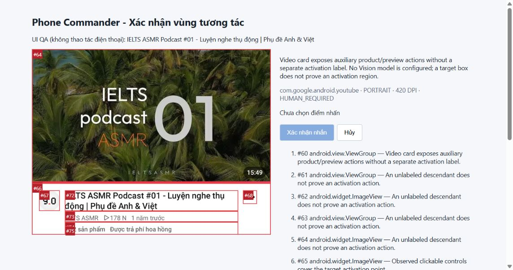

# Milestone 2.6: Visual Grounding và Evidence-based Interaction

Kiểm thử ngày 14/10/2026, một Samsung A50s SM-A507FN Android 11. Không thay model, system prompt hay Action Plan schema; không cài/gỡ APK, không đăng nhập hoặc thay đổi cài đặt điện thoại. Giữ nguyên backend Appium/Native/Web/serial lock và guard BLOCKED/AMBIGUOUS. Không triển khai Goal Planner, Recovery Engine hoặc Multi-device Agent.

## Kết luận

Đã triển khai **visual observation dựa trên hình học**, thu bằng chứng ảnh thật, review thủ công và grounded-tap có kiểm tra lại. **Không có Vision Model được cấu hình; không tuyên bố hệ thống hiểu ảnh bằng AI.** YouTube vẫn dừng an toàn khi chưa có activation evidence hoặc xác nhận của người dùng. Chưa nghiệm thu end-to-end mở đúng video thứ hai bằng grounded tap thật.

Chrome/Settings đã PASS hồi quy thiết bị; API có 7/7 cases PASS; bộ unit cũ được giữ và bổ sung visual tests. Grounded tap có bằng chứng ở unit/component test với mock Appium, không dùng kết quả đó để tuyên bố đã nhấn thật trên điện thoại. UI workbench đã được kiểm tra chọn điểm, xác nhận và hủy trong chế độ QA không tác động điện thoại.

## File tạo và sửa

| File mới | Vai trò |
| --- | --- |
| `lib/android/visual-grounding.ts` | Evidence collection, PNG/geometry/pixel consistency, single-use pending confirmation, grounded gesture |
| `lib/android/visual-review.ts` | HTML workbench ảnh/candidate và chuyển pointer CSS sang tọa độ screenshot |
| `tests/visual-grounding.test.cjs` | Unit/component cases cho ảnh, tọa độ, policy, stale state và cancellation |
| `tests/visual-grounding.integration.cjs` | Opt-in YouTube thật; lưu evidence; workbench loopback trong Session gốc; chế độ preview QA không Session |
| `docs/milestone-2.6-visual-grounding-report.md` | Báo cáo này |
| `docs/m26-visual-review-desktop.png`, `docs/m26-visual-review-mobile.png` | Screenshot browser của ảnh thật có candidate overlay, ở chế độ UI QA |

| File sửa | Nội dung |
| --- | --- |
| `lib/android/state-observer.ts` | Native-only read để thu evidence không chuyển Web Context giữa hai ảnh |
| `lib/android/exploration/types.ts`, `ui-explorer.ts` trong cùng thư mục | Trả target/selection đã có bằng chứng khi activation resolution bị chặn; không thêm ordinal bằng suy đoán |
| `lib/android/condition-executor.ts` | Chỉ kích hoạt visual ở nhánh resolver AMBIGUOUS; API nội bộ confirmVisualTap và verifier sau tap |
| `lib/android/errors.ts` | Visual evidence/capture failure kèm lỗi, không thay error enum |
| `types/execution.ts`, `app/api/executions/route.ts` | Step bị chặn có evidence visual riêng |
| `tests/milestone25.integration.cjs` | TS hook hỗ trợ default-import interop cho sharp |
| `package.json`, `package-lock.json`, `pnpm-lock.yaml` | Khai báo sharp 0.35.5 trực tiếp, giữ phiên bản đang có; không dùng model ảnh mới |
| `README.md` | Lệnh chạy, budget, session lifetime và giới hạn human fallback |

Không nhận các thay đổi dirty từ lượt trước là thay đổi mới. Không sửa selector theo kiểu thử vị trí cho tới khi PASS.

## Kết hợp hierarchy và screenshot

Fallback chỉ chạy sau khi có target thật và lý do không thể kích hoạt. Target ordinal giữ selection từ discovery memory đã xác minh origin/continuity; generic target giữ nhãn thực tế. Không chụp ảnh ở mọi action hoặc mọi vòng polling.

Trong khóa thao tác của cùng ManagedSession:

1. Đọc native hierarchy/foreground/activity/viewport mới. So fingerprint với snapshot discovery.
2. Chỉ cho capture ở ba app đã kiểm thử (YouTube/Chrome/Settings), từ chối field đang nhập và resource nhạy cảm được nhận diện. Đây là allowlist về quyền capture, không phải thuật toán vị trí riêng YouTube.
3. Lấy orientation, density DPI, system bars và window rectangle qua Appium; chụp PNG thật.
4. Đọc native hierarchy/geometry lần hai và chụp PNG thứ hai. Đối chiếu package/activity/nội dung/bounds/trạng thái hierarchy và hash pixel vùng màn hình.
5. Bỏ đúng vùng system bars đo được khi so pixel để tránh đồng hồ; không mask arbitrary video animation hoặc nội dung không ổn định.
6. Decode PNG bằng sharp với giới hạn 8 triệu pixel/16 triệu ký tự base64. Chỉ chấp nhận PNG một frame và mapping native-window/screenshot 1:1. Không suy ra scale chỉ từ DPI.
7. Crop riêng target để hiển thị/lưu; ghi geometry, candidate bounds/class/resource và lý do từng candidate. Không persist XML/full-screen screenshot hoặc gửi dữ liệu tới Ollama.

Nếu screen discovery đã đổi nhưng vẫn có duy nhất target cùng nội dung, có thể thu **ảnh chẩn đoán mới**. Ảnh đó không kế thừa ordinal/authorization cũ: `ordinalVerified=false`, status BLOCKED, không tạo pending tap. Nếu không còn target duy nhất, dừng và không dùng ảnh cũ.

`coherent=true` chỉ chứng minh consistency được đo, không chứng minh nội dung ảnh có thể click. Crop trống/đồng màu, screenshot thay đổi, orientation/geometry lệch hoặc candidate cạnh tranh đều không đủ để cho tap. Không có OCR/semantic segmentation/ảnh AI ở lượt này.

## Xác minh tọa độ và human fallback

Người dùng chọn điểm trong ảnh đã crop. Browser chuyển pointer theo boundingClientRect sang pixel crop, cộng crop origin để ra tọa độ **native full screen**. Không dùng CSS pixel, phần trăm thumbnail hay density trực tiếp làm tọa độ device.

Pending evidence có UUID, TTL 120 giây, gắn Session/device/snapshot/selection cụ thể. Không lưu lựa chọn như selector dùng lại. Chỉ một lần thử: sai token/goal, hết hạn hoặc failed revalidation cũng tiêu thụ pending authorization.

Trước tap, policy phải ALLOW; cờ `isSensitive=true` vẫn không được tự bỏ qua. Kiểm tra Session đang sống, hierarchy/geometry mới và hai ảnh mới còn khớp evidence. Point phải hữu hạn, nằm trong target sau ancestor clipping với margin 4 px, ngoài system insets và không trùng control clickable cạnh tranh. Target/control nhạy cảm vẫn bị chặn. Chỉ sau đó gửi `mobile: clickGesture`.

Sau tap, verifier xác minh selected video title trong player hoặc nội dung/URL browser. Target chưa có verifier đáng tin chỉ SENT/DISPATCHED, không SUCCESS. Không tự retry gesture khi hậu điều kiện chưa rõ.

Workbench opt-in bind `127.0.0.1` ở cổng random, đường dẫn random token; kiểm tra Host/Origin/content type, body tối đa 2048 ký tự, single-use POST và CSP. Xác nhận/Hủy/expiry kết thúc workbench; giữ Session gốc cho đến cleanup. Browser QA dùng chế độ riêng, không tạo Session và không gửi tap dù chọn/xác nhận.

**Giới hạn tích hợp:** workbench hiện nằm trong CLI opt-in, không phải luồng resume trong Dashboard. API execution trả visual evidence rồi vẫn đóng Session khi step thất bại; không thể dùng ảnh/token đó để nhấn trên Session khác. Human confirmation này chỉ giải quyết activation evidence của thao tác policy đã cho phép, không là cơ chế xác nhận hành động nhạy cảm mới.

## Kết quả thiết bị thật

### YouTube

Bằng chứng đầu tiên: thư mục TEMP `phone-commander-m26-1791948836636`, gồm report/evidence JSON, target PNG và HTML review. Query `podcast tiếng Anh`; phát hiện video thường thứ hai `IELTS ASMR Podcast #01 - Luyện nghe thụ động | Phụ đề Anh & Việt`.

- OPEN 0.860 s; WAIT search 0.786 s; CLICK search 4.242 s; INPUT 4.544 s; ENTER 3.761 s; WAIT video_list 3.403 s.
- Resolver không cấp điểm kích hoạt riêng cho card có `2 sản phẩm`; goal BLOCKED, chưa gửi click vào card.
- Thu evidence **7.624 s**, `coherent=true`, `HUMAN_REQUIRED`, native screenshot **1080 x 2340**, portrait, **420 DPI**.
- Crop target `[0,909,1080,1750]`. Status bar `[0,0,1080,83]`; navigation bar `[0,2214,1080,2340]`.
- Candidate #60 là card gộp; #61-64 là vùng/ảnh thumbnail không có nhãn activation riêng; #67 là avatar, #68 là menu phụ; các vùng title/metadata/product không có semantic native label đầy đủ.
- Nhìn ảnh thật có thể thấy thumbnail, title và Sản phẩm; **engine không tự suy luận chữ/thumbnail từ ảnh**, không dùng tâm card để vượt guard. Session cleanup PASS.



Lần đầu `phone-commander-m26-1791948631408` bị TIMEOUT chờ search_button trước khi có target; không có visual evidence và không tính PASS. Hierarchy đọc sau đó đã cho thấy nút `Tìm kiếm`; chỉ tăng budget bài thử lên 30 giây, không sửa selector production.

Lần `phone-commander-m26-1791949774458` dừng vì native UI đổi trước capture, ghi visualFailure và không dùng ảnh/token cũ. Không coi đây là thành công human tap.

Lần cuối `phone-commander-m26-1791950034682` đi qua resolver/native click thông thường, nhưng **TIMEOUT hậu điều kiện sau 60.416 s**, cleanup PASS. Không có visual fallback vì resolver native ở lần này không bị chặn trước thao tác. **Không tính là đã mở đúng video**, không tính là grounded tap đã PASS. Script đang chạy lúc đó còn gắn outcome BLOCKED cho TIMEOUT; bản script hiện hành đã phân biệt TIMEOUT kỹ thuật là FAIL. Không retry click hay sửa selector để vượt verifier. Bằng chứng có overlay phía trên thuộc lần collection thật đã ghép ổn định, không phải ảnh được phép dùng cho lần click cuối này.

Inspect sau cleanup (`phone-commander-m25-resolution-youtube-1791950400918.json`) quan sát launcher, không phải trang YouTube. Không suy ra nguyên nhân chuyển foreground hoặc thành công của video từ lần đọc đó; Session inspect đã đóng. Không có tap grounded thật được xác nhận ở lượt này.

### Chrome

Report `phone-commander-m25-resolution-chrome-1791949282293.json`: PASS/cleanup PASS. Query `công thức nấu phở`; native có lần chỉ 30 node nhưng `WEBVIEW_chrome` cung cấp DOM thật. Kết quả thứ ba mở bài `https://www.huongnghiepaau.com/pho-bo`, title/h1 `Cách Nấu Phở Bò Ngon, Nước Dùng Đậm Đà Chuẩn Vị`, readyState complete. Không gây context/Session xung đột bởi visual fallback.

Không ép Web Context thất bại trên máy chỉ để lấy screenshot. Trường hợp cả native và DOM thiếu target đáng tin phải BLOCKED; chưa chứng minh grounded tap thật cho nội dung web hoàn toàn không được accessibility/DOM cung cấp. Mapping/ảnh lệch và Web Context fallback có unit regressions riêng.

### Settings

Report `phone-commander-m25-resolution-settings-1791949496275.json`: PASS/cleanup PASS. Mục `Thông tin điện thoại` ban đầu MISSING, tìm được sau **5 scroll / 6 snapshot**, WAIT **22.851 s**; OPEN **8.295 s**. Không nhấn mục hay thay đổi setting. Không kích hoạt xử lý ảnh trong luồng bình thường.

### API và UI QA

API thật `phone-commander-api-integration-1791949017205.json`: **7/7 PASS**; policy false-positive/false-negative/unknown, verified foreground, SENT, TIMEOUT, overlapping409/cancel/cleanup. Một lần API test khác bị chạy khi bài YouTube đang giữ lock (`1791948876242`), nên assertion lock trống FAIL trước Session creation; không tính vào regression PASS. Sau khi Session YouTube đóng đã chạy lại tuần tự và PASS.

Browser QA: desktop và mobile 390 x 844, image naturalWidth1080; mobile không horizontal overflow (page width375 <= viewport390). Chọn điểm tạo tọa độ full-screen đúng crop origin; Xác nhận trả `QA hoàn tất, không thao tác điện thoại`; Hủy trả `Đã hủy, không gửi nhấn`. Phiên QA không phải bằng chứng tap trên điện thoại. Snapshot desktop/mobile được lưu cạnh report. Server/tab QA đã được đóng.

## Hiệu năng và test

Giới hạn **6 screenshot/execution** (collection và revalidation đều tính), mỗi collection/revalidation tối đa **20 giây**, mỗi pending confirmation **120 giây**. Không xử lý ảnh liên tục, không gọi AI cho ảnh, không thay model trên máy 8 GB RAM. Buffer full-screen chỉ xử lý tạm; pending giữ fingerprint/pixel hash và ảnh crop, không giữ bitmap full-screen. Không có benchmark RAM/CPU hệ thống nên không tuyên bố mức dùng RAM đã đo.

sharp 0.35.5 đã có từ dependency Next; nay khai báo trực tiếp. npm lockfile được kiểm tra bằng `--package-lock-only --ignore-scripts`, không đổi phiên bản dependency khác; npm bổ sung metadata bundled optional của Tailwind theo registry. Không chạy installer APK hay tải model.

Unit cases: paired evidence; single-use confirmed tap; screenshot/UI mismatch; scale/orientation; invalid/outside bounds/insets; competing/identical candidates; content mismatch; post-confirmation stale state; sensitive flag/consent/goal/expiry; Session timeout/error; cancellation; capture budget; blank image; review escaping/coordinate conversion; diagnostic image không cấp ordinal cũ. Các test Appium giả được ghi rõ là mock.

Production build chưa chạy. Lint toàn repo trước đó có 2 lỗi và warnings ngoài phạm vi; không khẳng định toàn repo sạch. Báo cáo chỉ nghiệm thu lint phần thay đổi và TypeScript/unit/API theo kết quả lần chạy cuối.

Kết quả cuối: **145/145 unit tests PASS** (129 cũ + 16 visual), **TypeScript PASS**, **lint phần thay đổi PASS**. API thật 7/7 PASS ở lần tuần tự nêu trên; không gọi lại bài API trong lúc Session kiểm thử khác hoạt động.

## Chạy lại và khả năng Vision

```powershell
node.exe --test tests/android-executor.test.cjs tests/state-observer.test.cjs tests/ui-exploration.test.cjs tests/milestone25-resolution.test.cjs tests/visual-grounding.test.cjs
node.exe node_modules/typescript/bin/tsc --noEmit
node.exe node_modules/eslint/bin/eslint.js lib/android app/api/executions/route.ts types/execution.ts tests/visual-grounding.test.cjs tests/visual-grounding.integration.cjs
node.exe tests/visual-grounding.integration.cjs R58MA78W6QK
node.exe tests/visual-grounding.integration.cjs R58MA78W6QK --review
```

Chỉ chạy một lệnh thiết bị mỗi lần, Appium/Next sẵn sàng, điện thoại mở khóa và có mạng. Mở REVIEW_URL được in bởi `--review` khi terminal còn chạy; lựa chọn offline hoặc Session đã đóng không thể thực thi. Giữ ảnh/report local; kiểm tra trước khi chia sẻ. Bài thử mới tải `.env.local` bằng `@next/env`.

`VisionGroundingProvider` là interface mở rộng **chưa có implementation/registration**: có thể đề xuất activation bounds/evidence trong tương lai, nhưng không tự cấp authorization. Cần model Vision thật được phê duyệt, privacy filtering, validation/benchmark và test lỗi riêng trước khi nối vào executor. Không gửi screenshot cho Qwen text-only và không tự tải model mới.

Nguồn API chính thức: [UiAutomator2](https://github.com/appium/appium-uiautomator2-driver) cung cấp screenshot, orientation, display density/system bars và clickGesture; [Sharp metadata/stats](https://sharp.pixelplumbing.com/api-input/) và [Sharp extract](https://sharp.pixelplumbing.com/api-resize/) dùng để decode/crop/hash pixel, không nhận diện ngữ nghĩa ảnh. Không dùng DPI như bằng chứng hiểu nội dung.

Dừng ở Milestone 2.6. Phần nền tảng hoạt động ở mức geometry + human-assisted fallback; tiêu chí mở đúng video bằng grounded tap thật còn cần người dùng xác nhận trên bằng chứng mới trong cùng Session.
