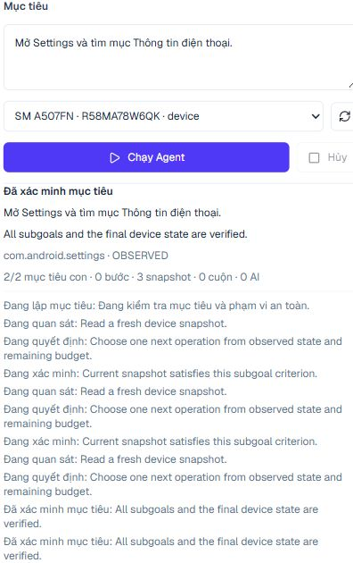

# Milestone 3: Goal Planner và Adaptive Agent Loop

Ngày kiểm thử: 14/10/2026. Phạm vi: một Samsung A50s, Android 11; Appium 3.8.0, UiAutomator2 8.7.0, APK helper hiện có được kiểm tra tương thích. Không cài/gỡ APK, không đổi model hoặc prompt của luồng phân tích cũ, không thay Action Plan schema. Dừng ở Milestone 3; chưa triển khai Recovery Engine đầy đủ hoặc multi-device Agent.

## Kết luận

Core Goal Planner, Decision Engine, Agent Loop, verification, memory, budget, progress và cancellation đã triển khai. Hai goal thật Chrome và Settings COMPLETED dựa trên trạng thái thiết bị, không bằng chuỗi action đầu vào. YouTube vẫn BLOCKED; không được coi video thứ hai đã phát thành công. Reasoning bằng Ollama thật chưa được nghiệm thu vì dịch vụ không phản hồi. Không tuyên bố Milestone 2.6 đã nghiệm thu đầy đủ hoặc Agent hiểu screenshot.

Human assistance được triển khai ở mức hợp đồng tối thiểu an toàn, chưa có Dashboard Workbench resume. Phạm vi goal hiện là mở app đã hỗ trợ, tìm phần tử theo nhãn và tìm/mở kết quả trong profile hiện có. Không phải agent hiểu và xử lý tùy ý mọi ứng dụng Android hay mọi yêu cầu đa ứng dụng.

## Kiến trúc

```text
Goal text -> Goal Planner -> validated Goal + verifiable criteria
  -> one device execution / one Appium Session
  -> OBSERVE -> independent EVALUATE -> DECIDE (rules first / bounded Ollama)
  -> scope + Security Policy -> existing Condition Executor / Explorer / Resolver
  -> Action Verifier -> fresh evidence -> short memory -> next iteration
  -> verified COMPLETED / BLOCKED / FAILED / CANCELLED -> Session cleanup
```

Không tạo Executor/Observer/Discovery Memory trùng lặp. Hook accounting bổ sung được bật cho Agent nhưng không đổi hành vi mặc định của luồng cũ. Observer native và DOM dùng cùng Session; không có hai vòng polling đồng thời trên một điện thoại. ADB vẫn phục vụ discovery/backend hiện hữu, không tự chuyển backend khi Appium lỗi.

### Goal Schema

`GoalSpec`: app, operation (`OPEN_APP`, `FIND_ELEMENT`, `OPEN_RESULT`), query/targetText, resultType, ordinal, isSensitive. Goal chứa UUID, originalRequest, description, packageName, subgoals, currentSubgoal, limits, allowedActionScope và safetyRequirements.

Các completion criterion là `FOREGROUND`, `SEARCH_RESULTS`, `TARGET_VISIBLE`, `DESTINATION`. Mỗi subgoal có ID và trạng thái PENDING/VERIFIED. Goal Planner dùng grammar bảo thủ cho yêu cầu rõ; yêu cầu chưa rõ có thể gọi reasoner JSON. Không trả action array; kiểm tra độc lập app/query/ordinal để model không làm mất hoặc thay mục tiêu. Yêu cầu ngoài phạm vi bị từ chối, không giả vờ hoàn thành phần còn lại.

### Decision Schema

Zod strict, gồm chín loại: `OBSERVE_AGAIN`, `EXECUTE_ACTION`, `EXPLORE_UI`, `WAIT_FOR_CONDITION`, `REPLAN_SUBGOAL`, `REQUEST_HUMAN_ASSISTANCE`, `COMPLETE_SUBGOAL`, `COMPLETE_GOAL`, `FAIL_GOAL`. Action nội bộ dùng bản strict của các option Executor đã hỗ trợ; không sửa schema Action Plan cũ. Extra shell, JavaScript, tọa độ tự sinh và action ngoài phạm vi không được chấp nhận.

Rules kiểm tra dialog, app foreground, ô tìm kiếm được focus, query chính xác, kết quả render, mục tiêu trong viewport và evidence trước khi thao tác. LLM chỉ được hỏi khi rules chưa đủ và không hỏi lại cùng fingerprint/subgoal. Claim COMPLETE của model không có giá trị nếu evaluator độc lập chưa xác minh criterion.

### Verification và Memory

- Mỗi bước mới dựa trên snapshot mới; element vẫn được Executor/Resolver kiểm tra lại trước thao tác.
- App mở thành công cần foreground thật. Search cần query đúng và kết quả đã render, không chỉ ENTER được gửi.
- Đích Chrome cần bằng chứng DOM và xác minh kết quả đã chọn. YouTube cần bằng chứng nội dung/ordinal và trang video theo verifier hiện có.
- Hậu điều kiện cuối của Executor có thể được evaluator kiểm tra lại từ snapshot thật không quá 5 giây; snapshot này chỉ dùng kết thúc goal, không làm quyền cho action tiếp theo. Status VERIFIED một mình không đủ.
- Memory ngắn hạn lưu metadata tối đa 12 observation, action/verification/reason ngắn, failure và selection; không lưu lịch sử raw XML. Tận dụng Discovery Memory cho danh sách nội dung xuyên viewport.
- Context reasoner tối đa 16.000 ký tự, 45 node, lịch sử ngắn; không gửi ảnh, ẩn giá trị ô nhập và giảm nhãn không cần thiết. Đây không phải bộ khử dữ liệu nhạy cảm hoàn hảo; triển khai sản xuất cần review thêm ranh giới dữ liệu.
- Không gửi lại click/input/key chưa xác minh chỉ vì màn hình đổi. BACK dismiss dialog phải kiểm chứng dialog biến mất. Replan chỉ lùi về criterion đã có, không hạ tiêu chuẩn hoặc thêm/bỏ mục tiêu.

### Budgets và Human Assistance

Mặc định: 240.000ms, 18 bước, 120 snapshot, 24 scroll, 4 reasoning, 2 retry, 2 replan, 40 iteration. Snapshot tính cả các lần đọc native/DOM bên trong Executor, không chỉ outer loop. Gesture có hook ngân sách trước khi gửi. Reasoning tính cả planning và lần gọi thất bại, timeout tối đa 45 giây hoặc thời gian còn lại.

Loop dùng fingerprint, tiến độ và action history để chặn lặp. AbortSignal nối request/stream cancellation và deadline. Mỗi goal tạo một Session, đóng trong finally trước event complete cuối; lỗi cleanup không được báo COMPLETED.

Hợp đồng assistance phân biệt `INTERACTION_POSITION`, `SENSITIVE_ACTION`, `UNKNOWN_UI`, có evidenceId/expiry khi có evidence. Hiện `resumable:false`, `sessionRetained:false`: trả NEED_HUMAN_ASSISTANCE rồi BLOCKED, đóng Session. Không có API resume hoặc authorization ngầm. Dashboard chỉ hiển thị evidence chẩn đoán; xác nhận vị trí không thay cho xác nhận nhạy cảm. Không có Pause/Resume; Cancel có tác dụng backend.

## File Tạo/Sửa

File mới:

- `lib/android/agent/schema.ts`: Goal/Decision/Progress contracts.
- `budget.ts`, `memory.ts` cùng thư mục: counters, timings, short memory và loop guard.
- `goal-planner.ts`: ngôn ngữ tự nhiên thành criterion, bảo toàn ý định.
- `decision-engine.ts`, `evaluator.ts`: rules/reasoning và kiểm chứng độc lập.
- `ollama.ts`: bounded JSON `/api/chat` dùng model hiện có.
- `agent-loop.ts`: orchestration, policy scope, progress, cleanup.
- `app/api/agent/route.ts`: API strict, NDJSON, cancellation và device lock.
- `components/commands/AgentGoalPanel.tsx`: Goal Agent UI và hủy thật.
- `tests/agent.test.cjs`, `tests/agent.integration.cjs`, `tests/agent-api.integration.cjs`.
- Báo cáo này, ảnh `m3-dashboard-desktop.png`, `m3-dashboard-mobile.png`.

File hiện hữu sửa trong Milestone 3:

- `lib/android/state-observer.ts`, `hybrid-context-observer.ts`: accounting native/DOM, selection metadata.
- `lib/android/exploration/scroll-controller.ts`, `ui-explorer.ts`: scroll budget hook, Discovery Memory summary.
- `lib/android/errors.ts`: selection/interaction metadata khi verification thất bại.
- `lib/android/action-verifier.ts`: bằng chứng DOM cho đích Chrome.
- `lib/android/condition-executor.ts`: accounting, verified snapshot hook và selection outcome; tái sử dụng cơ chế cũ.
- `components/commands/AICommandPanel.tsx`: tab Goal Agent, giữ Action Plan mặc định.
- `components/layout/AppSidebar.tsx`, `AppHeader.tsx`, `DashboardLayout.tsx`, `app/page.tsx`: icon rail mobile và min-width/padding để Goal panel không bị ép nhỏ; không xây lại Dashboard.
- `README.md`: cách dùng, test commands và trạng thái nghiệm thu mới.

Worktree đã có nhiều thay đổi từ Milestone trước; danh sách này không coi mọi git diff hiện hữu là thay đổi M3.

## Kiểm Thử

| Hạng mục | Kết quả |
| --- | --- |
| TypeScript `tsc --noEmit` | PASS |
| ESLint phạm vi Agent và các file tích hợp | PASS, không có error/warning sau khi bỏ import User không dùng |
| Unit hồi quy M1–2.6 + Agent | 168/168 PASS, gồm 23 test Agent |
| API Agent trên điện thoại thật | 4/4 PASS |
| API Observer/Executor hồi quy thật | 7/7 PASS |
| Chrome goal thật | COMPLETED |
| Settings goal thật | COMPLETED |
| YouTube goal thật | BLOCKED, đúng giới hạn an toàn; mục tiêu phát video chưa đạt |
| Ollama adapter | Mock PASS; reasoner model thật chưa PASS |
| Dashboard Goal Agent | COMPLETED, 2/2 criterion Settings, 0 action, 3 snapshot vì mục đã có sẵn |

Unit mock kiểm tra popup bất ngờ, tải chậm, không có element, sai foreground/replan, hậu điều kiện thất bại, không gửi lại click, phát hiện loop, hết thời gian/bước/snapshot, cancel, cleanup lỗi, policy denial, strict schema, cache reasoning, bảo toàn app/query/ordinal và snapshot completion thật/cũ. Không coi mock là bằng chứng chạy trên điện thoại.

API Agent kiểm tra payload thừa bị 400, goal nhạy cảm bị 422, stream goal thật COMPLETED và cleanup, execution chồng lấn 409/cancel giải phóng khóa. API cũ kiểm tra sensitive/semantic guards, foreground VERIFIED, key chưa xác minh chỉ SENT, timeout dừng bước sau và cancellation. Các bài chạy tuần tự, không tạo Session đồng thời.

Lint toàn repo vẫn có lỗi tồn tại trước ở `DeviceScreen.tsx` (setState trong effect), `ExecutionDetailModal.tsx` (explicit any) và warnings cũ; không tuyên bố toàn repo lint sạch. Chưa chạy production build.

### Thiết Bị Thật

Chrome: `Mở Chrome, tìm công thức nấu phở và mở kết quả đầu tiên.` Agent tự quan sát/chọn từng action, 3/3 criterion VERIFIED; 5 bước, 36 lần đọc, 1 scroll, 0 reasoning, 0 retry/replan. Đích được kiểm chứng qua DOM, không dựa vào click đã gửi.

Settings: `Mở Settings và tìm mục Thông tin điện thoại.` 2/2 criterion VERIFIED; 3 bước, 17 lần đọc, 6 scroll, 0 reasoning, 1 retry. Lần khám phá đầu hết thời gian; Agent đọc lại rồi tiếp tục khám phá có giới hạn và tìm đúng mục. Không nhấn đổi cài đặt. `--fresh` chỉ đóng app trước test để đưa danh sách về ban đầu, không phải action plan của Agent, không xóa dữ liệu.

YouTube lần cuối: `Mở YouTube, tìm podcast tiếng Anh và phát video thứ hai.` Mở app, nhấn tìm kiếm, nhập query và ENTER đều VERIFIED; 2/3 criterion đạt. 5 bước được yêu cầu (không đồng nghĩa 5 thao tác đã gửi), 23 lần đọc, 3 scroll. Resolver chặn `video_card_2`: **Observed clickable controls cover the target activation point.** Không gửi tap đoán. Visual evidence sau đó báo nguồn màn hình đã thay đổi, `coherent:false`, `ordinalVerified:false`; ảnh mới chỉ để chẩn đoán, không cấp quyền tương tác. Session đã đóng.

Lần YouTube trước cũng BLOCKED: 1 replan và 1 lần gọi Ollama không phản hồi trong khoảng 45 giây. `/api/tags` không phản hồi trong các probe 8/20 giây. Không tự đổi model hoặc restart dịch vụ Ollama. Lượt YouTube cuối không cần gọi model. Tình trạng thiếu bằng chứng activation chưa được giải quyết bằng Vision/human confirmation.

### Thời Gian Đo

Đơn vị ms; từ báo cáo CLI máy thật:

| Goal | Observation | Reasoning | Execution | Verification | Total |
| --- | ---: | ---: | ---: | ---: | ---: |
| Chrome | 38917 | 0 | 39657 | 19300 | 59934 |
| Settings | 19341 | 0 | 30151 | 1072 | 47224 |
| YouTube lượt cuối | 25062 | 0 | 39183 | 7403 | 55763 |

Các phase là inclusive/nested: observation/verification có thể nằm trong execution, không cộng chúng thành total. Verification đo native condition và evaluator; vòng chờ post-click DOM chưa có timer riêng đầy đủ nên một phần còn nằm trong execution. Snapshot là lần đọc thử, không chỉ lần đọc thành công. Reasoning 0 ở các lượt rules không chứng minh model chạy nhanh hay reasoning thật đã PASS.

Báo cáo raw đã làm gọn tại TEMP: `phone-commander-m3-chrome-1791953105710.json`, `phone-commander-m3-settings-1791953456804.json`, `phone-commander-m3-youtube-1791954839429.json`, API Agent `phone-commander-m3-api-1791956196902.json`, API hồi quy `phone-commander-api-integration-1791956912862.json`. Không log base64 screenshot trong các báo cáo JSON này.

## Dashboard và Vận Hành

Tab Goal Agent dùng endpoint riêng, stream lý do ngắn có thể đối chiếu với UI evidence; không hiển thị chain-of-thought. Desktop 1440px và mobile 390px đã kiểm tra; panel mobile rộng khoảng 271px, không có horizontal overflow nội bộ. Các phần Dashboard demo cũ không được coi là Agent progress/history thật.

Server Next dev cũ xuất hiện trạng thái runtime không khớp backend interfaces mới: API goal lỗi dù CLI cùng source chạy được. Sau restart dev server, API Agent 4/4 và browser goal PASS. Giữ server tại `http://localhost:3000`; Appium/Ollama không được restart bởi bài thử này. Nếu sửa backend đang chạy lâu và gặp dấu hiệu tương tự, dừng dev server đúng process rồi khởi động lại; không kết luận mọi lỗi đều do cache.



## Giới Hạn và Bước Tiếp

- Chưa có VisionGroundingProvider thật. Text-only Qwen không nhận screenshot. Geometry không phải hiểu ảnh; coordinate suggestion không tự thành authorization.
- Chưa có workbench/resume Dashboard, chưa giữ Session chờ xác nhận, chưa có Pause/Resume. Không tự retry hành động nhạy cảm/không xác minh.
- Rules/criteria tận dụng profile ứng dụng hiện có; chưa giải quyết yêu cầu nhiều app, lựa chọn kết quả theo độ phù hợp ngữ nghĩa tùy ý hoặc các app chưa có matcher/verifier.
- Ollama thật cần khôi phục và kiểm thử riêng; nhánh ambiguous có thể dừng UNKNOWN_UI thay vì tiếp tục khi model lỗi.
- Recovery M4 có thể nhận failure/evidence/budget/action history từ contracts này, đề xuất phương án nhưng phải qua DecisionSchema, scope, policy và verification như hiện tại; không được nới tiêu chuẩn goal hoặc đổi Session từng bước.
- Bước tiếp theo nên là reasoning thật, human resume có TTL và re-observation/authorization mới, rồi xử lý activation YouTube có evidence đáng tin cậy. Không coi các bước đó là đã triển khai trong M3.
