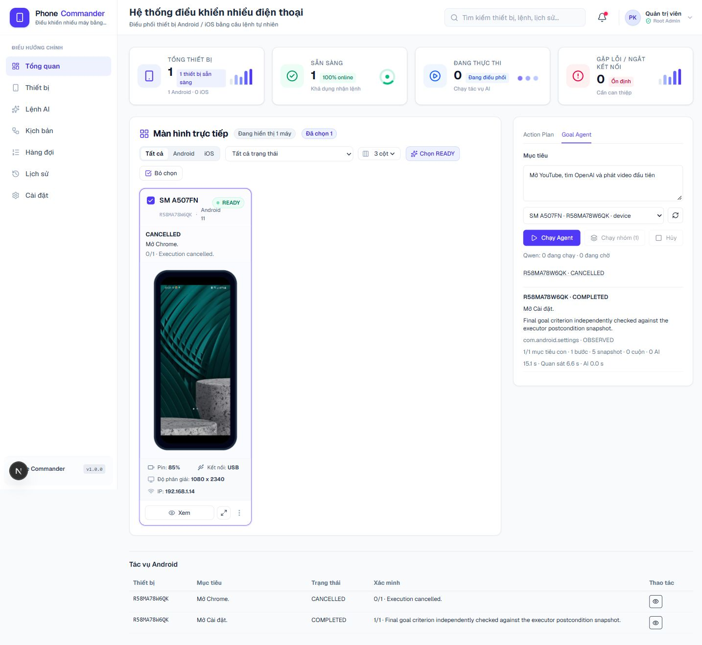

# Milestone 5: Multi-Device Autonomous Agent

Date: 2026-10-16. Scope: local Windows, authorized USB Android devices. No model, public Action Plan schema, Security Policy or Recovery Engine rewrite.

## Implementation

**IMPLEMENTED:** A detached local Node worker owns a Device Runtime Registry. Each execution has its own serial, goal, budget, cancellation controller, Agent memory/history, Session, recovery/subtask progress and Human Assistance state. The registry admits at most four active executions and one per serial; the existing device lock remains the authoritative Android owner. Atomic batch admission creates independent executions with a shared batch ID and idempotent request ID.

The worker survives Dashboard reload, viewer disconnect and Next.js HMR. Its authenticated HTTP server binds only to loopback on a random port. Next.js routes bridge commands and snapshots; they do not own execution lifetime. The private per-project TEMP journal excludes screenshots/XML and Human Assistance tokens. Restarted unfinished executions become BLOCKED, never automatically replayed or resumed. Terminal completion is published only after the Agent cleanup path finishes.

Appium Sessions retain the requested UDID and reserve distinct system/chromedriver ports through ownership-checked filesystem leases and free-port probes. MJPEG gets an isolated port only when explicitly enabled. Existing device locking is reused; uncertain Session creation/deletion retains its device lock and port leases for inspection. Cleanup never releases another Session's lease. This follows the driver's [parallel-test port requirements](https://github.com/appium/appium-uiautomator2-driver#parallel-tests).

All Dashboard Agent reasoning and the legacy Action Plan interpreter use one shared scheduler in the worker: one running model request, at most 16 waiting, round-robin owner preference and FIFO within an owner. Queue wait counts toward the request deadline. Queued cancellation, timeout, overflow and failure are handled independently. A cancelled running request keeps its lease until its actual I/O settles. Android actions that need no model do not take this reasoning lease. Model configuration remains unchanged.

## Dashboard

- Select real USB Android devices individually or together; send different individual goals or one batch goal.
- Inspect execution-specific progress, verification, recovery/subtasks and historical results; cancel one execution or its batch.
- Bind Human Assistance to execution, device, token and evidence. Only the viewed image is fetched through an identity-checked, expiring evidence endpoint; ordinary polling does not resend all images.
- Reattach to worker state after reload without cancelling the Agent. Opening an older history row shows that exact execution, not just the newest result for its phone.
- Use one central runtime polling hook and one preview scheduler. Selected previews refresh approximately every four seconds, unselected every twenty seconds; hidden pages pause previews. Backend captures are coalesced and compressed. Detail images are higher resolution; these are refreshed ADB images, not a video stream.
- Live-phone mock manual controls are disabled. Synthetic demo history and misleading execution overlays are not shown for real devices.

Desktop and mobile layout checks passed without page-level horizontal overflow. The history table scrolls within its own container on mobile. These screenshots show **one real phone**, not proof of simultaneous physical devices:

[Mobile Dashboard screenshot](milestone-5-mobile.png)

## Automated Results

**SIMULATED PASS:** `node --test --test-reporter=spec tests/*.test.cjs` completed with **249/249 passed**, zero failed/skipped. The 19 new multi-device tests use fake Android/model adapters; HTTP and port tests use actual local sockets/filesystem resources, not real parallel phones.

Coverage includes independent goals/state/memory/budgets, parallel actions, A recovery while B continues, failure/disconnect isolation, reconnect without replay, independent batch cancellation, concurrent-submit idempotency, viewer detachment, journal restart safety, queue fairness/overflow/cancel/timeout/error recovery, distinct Session ports and UDIDs, uncertain Session ownership retention, concurrent-open guarding, device-bound assistance, cross-device hierarchy rejection, expiring evidence delivery, historical Dashboard inspection and B Android execution while A waits for AI.

TypeScript (`tsc --noEmit`) and ESLint on the Milestone 5 changed source/test files passed. No production-build result is claimed. Automated tests are not end-to-end Android evidence.

## Real Android Results

**REAL ANDROID PASS, single phone only:** Samsung A50s, serial `R58MA78W6QK`, Android 11. Existing Appium/Ollama/Next.js services were checked. No APK was installed or removed, and Appium was not restarted with session override.

| Dashboard smoke | Result | Evidence |
| --- | --- | --- |
| Open Settings, reload browser while RUNNING | PASS | Same execution `8795a8de-9780-4d3b-a28b-d49d9d697b28` reattached and COMPLETED, 1/1 criterion, foreground `com.android.settings` independently verified. Total 15.074 s; 5 snapshots, 1 action, 0 model calls. |
| Open Chrome, cancel this execution in Dashboard | PASS | Execution `946c0bb1-b314-4572-8400-2a78e2e3cf4a` stayed pending cleanup, then CANCELLED. Total 9.423 s. No completion or replay claim. |
| Session cleanup | PASS | Both real Sessions returned DELETE HTTP 200, respectively 880 ms and 689 ms. |
| Restart idle worker | PASS | Finished task history restored without auto-resuming actions. |
| Inspect historical Settings execution | PASS | Dashboard showed its COMPLETED result while the device card retained the newer Chrome CANCELLED result. |

The Chrome action had started before cancellation; cancellation does not undo actions already dispatched. These smoke goals exercised rules-based decisions, **not real Qwen inference**.

## Remaining Limits

**NOT TESTED:** two physical phones simultaneously, real multi-phone batch execution, real concurrent Qwen workloads, real cross-device recovery, and real Human Assistance resume. Only one phone was available; simulated isolation results must not be labeled REAL MULTI-DEVICE PASS. Long YouTube/Human Assistance tests were intentionally not repeated in this scope; their earlier acceptance status is not upgraded by this milestone.

The current cap is four active USB executions, with two as the immediate validation target. No 100-device, iOS or cloud claim. CPU/RAM/load benchmarking has not been performed; smoke timings above are not a multi-device performance benchmark.

A phone failure is isolated, but a whole worker/process crash interrupts all in-process Agents. The next API read can start a new worker; there is no separate always-running watchdog. Uncertain device/Session/port locks after hard crash require inspection; they are not blindly reclaimed. Reconnection does not resume an unverified action. Worker source edits require an idle graceful restart; Next HMR alone intentionally does not reload worker code. External CLI harnesses that call Ollama directly are outside the worker scheduler and must not run concurrently with Dashboard executions.

To stop: stop Next.js first, then `npm run agent:worker:stop`. This requests cancellation and Session cleanup. A still-polling Dashboard can otherwise start the worker again. To start normally: `npm run dev`; runtime access auto-starts the worker. Install full dependencies, including TypeScript used by the worker launcher.

## Main Files

- `lib/android/agent/device-runtime.ts`, `runtime-schema.ts`, `runtime-storage.ts`: per-device orchestration and safe task persistence.
- `lib/android/agent/worker-server.ts`, `worker-client.ts`, `request-origin.ts`, `scripts/agent-worker.cjs`: durable local worker, authenticated bridge and strict loopback origin checks.
- `lib/android/agent/reasoning-scheduler.ts`, `ollama.ts`, `budget.ts`, `agent-loop.ts`: shared reasoning and execution/device failure identity.
- `lib/android/appium/port-allocator.ts`, `session-manager.ts`: Session port ownership/lifecycle.
- `app/api/agent/runtime/route.ts`, `app/api/agent/route.ts`, `app/api/agent/assistance/route.ts`, `app/api/commands/interpret/route.ts`: worker-backed commands and compatibility entry points.
- `lib/android/screen-previews.ts`, `app/api/devices/[serial]/screenshot/route.ts`, `hooks/useDevicePreviews.ts`: coalesced compressed previews.
- `hooks/useAgentRuntimes.ts`, `hooks/useDashboardDemo.ts`, `lib/android/device-selection.ts`, `app/page.tsx`: shared Dashboard state and multi-selection.
- `components/commands/AgentGoalPanel.tsx`, `AICommandPanel.tsx`, `components/executions/AgentTaskHistory.tsx`: individual/batch submission, device-bound assistance and history.
- `components/devices/DeviceCard.tsx`, `DeviceGrid.tsx`, `DeviceDetailModal.tsx`, `DeviceScreen.tsx`, `components/dashboard/StatsOverview.tsx`, `components/layout/AppSidebar.tsx`: real per-device presentation and controls.
- `tests/multi-device-runtime.test.cjs`: 19 simulated integration/regression cases.
- `README.md`, `.env.example`, `package.json`: operation, worker scripts and optional MJPEG configuration.

Other pre-existing uncommitted changes from earlier milestones were preserved and are not attributed to this milestone.
